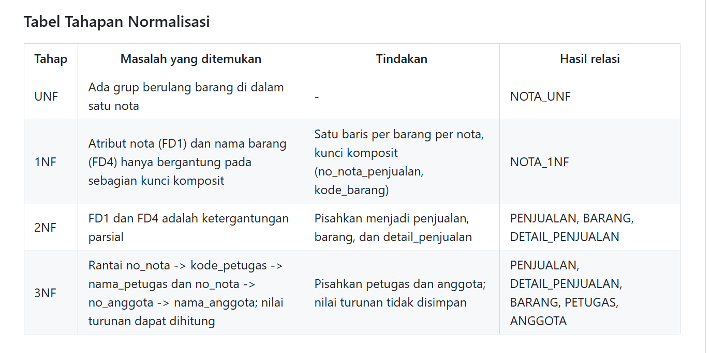
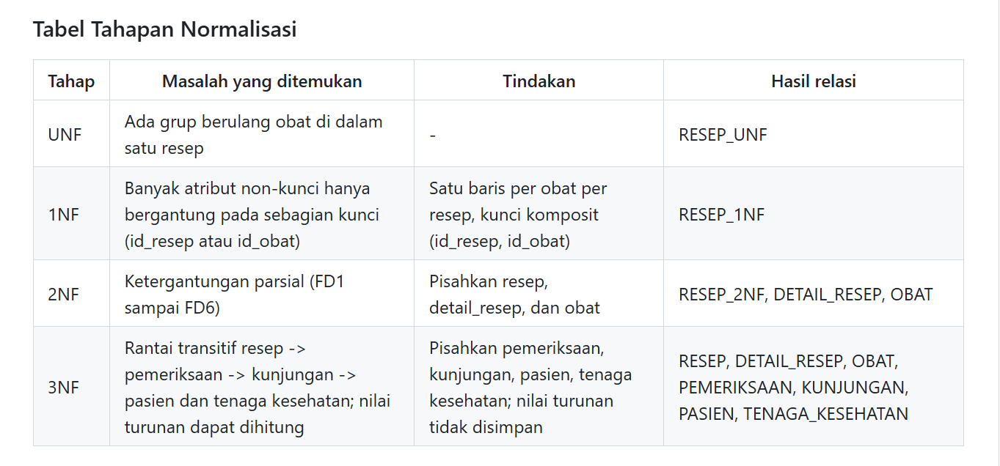

# Laporan Praktikum Basis Data - Pertemuan 04

**Nama:** Riska Nur Jazilah    **NIM:** 25430032    **Kelas:** A    **Tanggal:** 17 Oktober 2026

**Asisten/Dosen:** Dedi Irawan, S.Kom., M.T.I.

## 1. Tujuan Praktikum

Pada pertemuan ini saya belajar menemukan masalah pada data yang masih menumpuk di satu tabel (anomali ubah, sisip, dan hapus). Saya juga belajar menuliskan dependensi fungsional dari aturan bisnis, lalu memecah tabel sampai bentuk normal ketiga (3NF) dan memeriksa BCNF. Terakhir, saya menentukan nilai mana yang disimpan dan mana yang dihitung.

## 2. Ringkasan Dasar Teori

Data yang disimpan berulang dalam satu tabel besar bisa menimbulkan anomali. Anomali ubah terjadi saat satu fakta tertulis di banyak baris lalu hanya sebagian yang diubah. Anomali sisip terjadi saat satu fakta tidak bisa dicatat sebelum ada fakta lain. Anomali hapus terjadi saat menghapus satu fakta ikut menghilangkan fakta lain.

Dependensi fungsional A -> B artinya setiap nilai A pasti menentukan satu nilai B. Dependensi ini diturunkan dari aturan bisnis, bukan ditebak dari contoh data.

Normalisasi dilakukan bertahap. 1NF menghapus grup berulang. 2NF menghapus atribut yang hanya bergantung pada sebagian kunci. 3NF menghapus ketergantungan antar atribut non-kunci (rantai A -> B -> C). BCNF mensyaratkan setiap penentu adalah kunci kandidat. Nilai turunan yang bisa dihitung dari data lain sebaiknya tidak disimpan di tabel operasional agar tidak tidak-konsisten.

## 3. Hasil Langkah Percobaan

Langkah D dikerjakan pada kasus spreadsheet Kopma. Seluruh hasilnya ada di `p04_normalisasi_kopma_25430032.md`.

- **D.1 UNF ke 1NF.** Satu nota berisi grup berulang barang, lalu dipecah menjadi satu baris per barang per nota dengan kunci komposit (no_nota_penjualan, kode_barang).
- **D.2 Dependensi fungsional.** Ada enam dependensi (FD1 sampai FD6) yang diturunkan dari aturan bisnis AB-01, AB-04, dan AB-05.
- **D.3 2NF dan 3NF.** Tabel dipecah menjadi penjualan, detail_penjualan, barang, petugas, dan anggota. Nilai turunan (subtotal, jumlah, diskon, total) tidak disimpan.
- **D.4 Skema kanonik dan BCNF.** Hasil dicocokkan dengan Tabel 4.2, lalu setiap tabel diperiksa dan semuanya memenuhi BCNF.

Keterangan: tabel tahapan UNF ke 1NF ke 2NF ke 3NF pada kasus Kopma, ditampilkan dari repositori GitHub.

## 4. Jawaban Titik Analisis

**Titik Analisis 1.** Harga satuan ada pada kunci (no_nota_penjualan, kode_barang) karena menurut AB-04 harga di nota disimpan per baris dan tidak berubah walau harga barang naik. Kalau harga dipindah ke tabel barang, kenaikan harga akan mengubah nilai semua nota lama sehingga omzet tahun lalu menjadi salah.

**Titik Analisis 2.** Pada tabel operasional, data masih bisa berubah sehingga total lebih aman dihitung saat dibutuhkan. Tabel arsip adalah potret historis yang tidak boleh berubah, jadi total sengaja disimpan agar angkanya tetap beku. Dua keputusan itu konsisten karena tujuannya sama, yaitu menjaga angka tetap benar sesuai konteksnya.

**Titik Analisis 3.** Informasi pemasok barang kini tersimpan lewat jalur barang, detail_pembelian, pembelian, lalu pemasok. Keuntungannya, satu barang bisa dipasok banyak pemasok dan riwayatnya tercatat. Nama pemasok juga hanya disimpan sekali sehingga ejaan tidak berubah-ubah.

## 5. Hasil Latihan dan Modifikasi

**Latihan 1 (beberapa nomor telepon pemasok).** Nomor telepon tidak boleh ditumpuk dalam satu kolom karena melanggar 1NF. Solusinya relasi baru `PEMASOK_TELEPON (id_pemasok*, no_telepon, keterangan)` dengan kunci primer (id_pemasok, no_telepon).

**Latihan 2 (pelanggaran 3NF).** Jika nama_anggota disimpan di tabel penjualan, terjadi rantai id_penjualan -> id_anggota -> nama_anggota. Saya menunjukkan anomali ubahnya dengan kueri `UPDATE` pada satu nota, lalu `SELECT ... HAVING COUNT(DISTINCT nama_anggota) > 1` menunjukkan anggota yang sama punya dua nama. Detail data dan kuerinya ada di `p04_normalisasi_kopma_25430032.md` bagian E.

## 6. Tugas Mandiri: Milestone Proyek 04

Proyek saya adalah Klinik Sehat RNJ. Dokumennya ada di `p04_normalisasi_25430032.md`.

- **Dokumen sumber:** lembar resep obat. Formulir pendaftaran pasien tidak saya pakai karena hanya memuat satu baris data per pasien dan tidak punya grup berulang, jadi tidak ada yang bisa dinormalisasi.
- **Dependensi fungsional:** sembilan dependensi (FD1 sampai FD9) beserta kode AB yang mendasarinya, misalnya AB-05 untuk resep dan pemeriksaan, AB-06 untuk jumlah dan dosis obat.
- **Tahapan:** RESEP_UNF dipecah menjadi RESEP_1NF, lalu 2NF (resep, detail_resep, obat), lalu 3NF (resep, detail_resep, obat, pemeriksaan, kunjungan, pasien, tenaga_kesehatan).
- **BCNF:** semua tabel diperiksa dan memenuhi BCNF.
- **Nilai turunan:** subtotal_obat dan total_obat tidak disimpan karena dapat dihitung dari jumlah dan harga obat.
- **Perubahan ERD:** tidak ada, karena ERD Pertemuan 3 sudah memisahkan Resep dan Detail_Resep dan tidak memuat atribut subtotal atau total.

Keterangan: tabel tahapan normalisasi proyek Klinik Sehat RNJ, ditampilkan dari repositori GitHub.

## 7. Pembahasan dan Kendala

- Folder repositori di laptop saya hilang. Saya memeriksa GitHub dan repositori `basisdata-032` masih utuh, lalu saya mengerjakan berkas di Notepad dan mengunggahnya lewat fitur Add file, Upload files di GitHub.
- Formulir pendaftaran pasien yang saya anggap sebagai dokumen sumber ternyata tidak punya grup berulang. Saya menggantinya dengan lembar resep obat supaya tahapan 1NF sampai 3NF bisa ditunjukkan.
- Penamaan atribut di ERD berbeda dengan bentuk gabungan UNF (misalnya `nama` pada ERD dan `nama_pasien` pada UNF). Saya memberi catatan di dokumen agar tidak tertukar, dan hasil akhir 3NF saya samakan dengan ERD.

## 8. Kesimpulan

Normalisasi membuat data lebih konsisten karena satu fakta hanya disimpan di satu tempat. Dependensi fungsional harus diturunkan dari aturan bisnis, bukan dari contoh data. Nilai turunan seperti subtotal dan total sebaiknya dihitung, bukan disimpan di tabel operasional.

## 9. Pernyataan Penggunaan AI

Saya menggunakan Claude (Anthropic) sebagai asisten belajar. Bantuannya mencakup menjelaskan langkah normalisasi, menyusun draf `p04_normalisasi_kopma_25430032.md` dan `p04_normalisasi_25430032.md`, serta menyusun draf laporan ini. Saya memeriksa hasilnya terhadap buku praktikum, ERD, dan dokumen kebutuhan data proyek saya, lalu menyesuaikannya sebelum dikumpulkan.

## 10. Bukti Git

- Repositori: https://github.com/rnurjazilah-cyber/basisdata-032

Riwayat commit yang digunakan sebagai bukti pengerjaan Pertemuan 4 adalah sebagai berikut.

| Hash commit | Pesan commit |
|-------------|--------------|
| `af6c8d1` | `p04: normalisasi kopma` |
| `57da21a` | `p04: milestone proyek 4` |
| `83b7684` | `p04: laporan` |

## Checklist

| Status | Jenis | Yang harus ada |
|--------|-------|----------------|
| [√] | Berkas wajib | `p04_normalisasi_25430032.md` (proyek) dan `p04_normalisasi_kopma_25430032.md` (Kopma) |
| [√] | Bukti tangkapan layar | Tabel tahapan UNF → 1NF → 2NF → 3NF untuk Kopma dan proyek |
| [√] | Analisis wajib | Daftar dependensi fungsional beserta kode AB, serta keputusan menyimpan atau menghitung nilai turunan beserta alasannya |
| [√] | Identitas | Nama, NIM, kelas, pertemuan ke-4, tanggal, dan nama dosen |
| [√] | Titik Analisis dan Latihan | Titik Analisis 1 sampai 3 dan Latihan 1 sampai 2 dijawab dengan alasan |
| [√] | Pernyataan Penggunaan AI | Alat, tujuan, dan bagian yang dibantu |
| [√] | Keaslian | Tangkapan layar memperlihatkan akun ber-NIM dan jam sistem |
