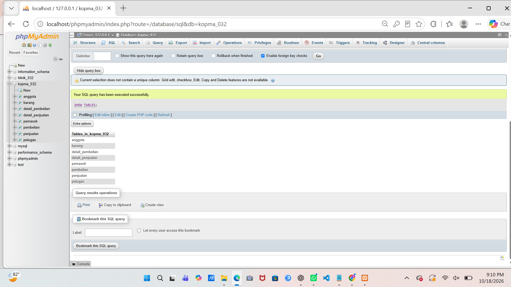
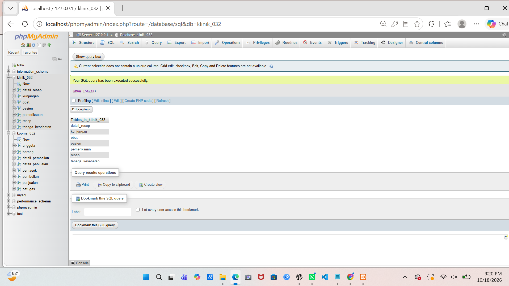
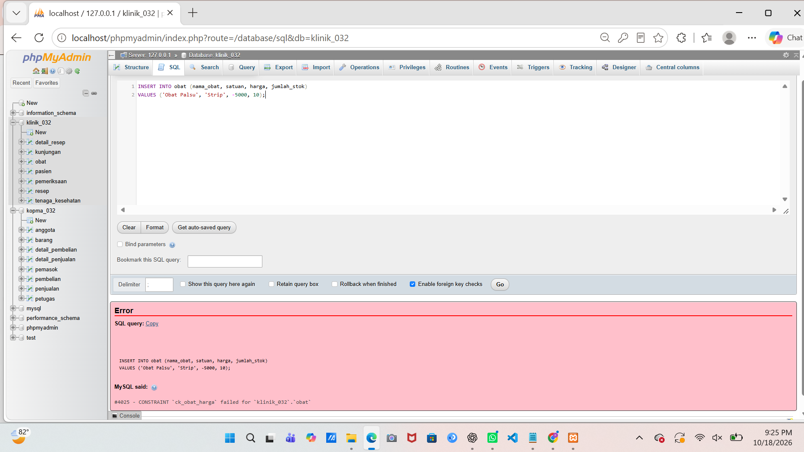
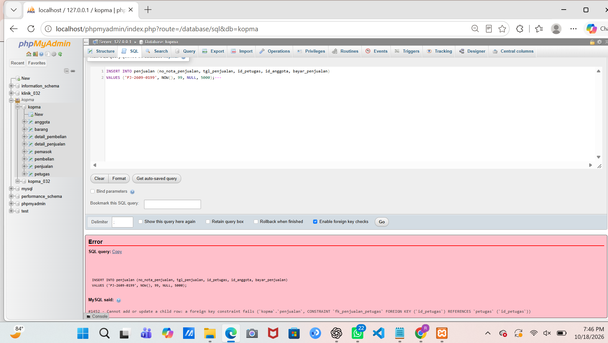
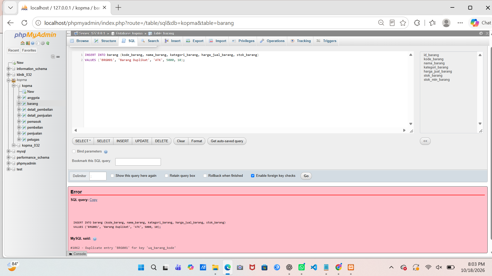
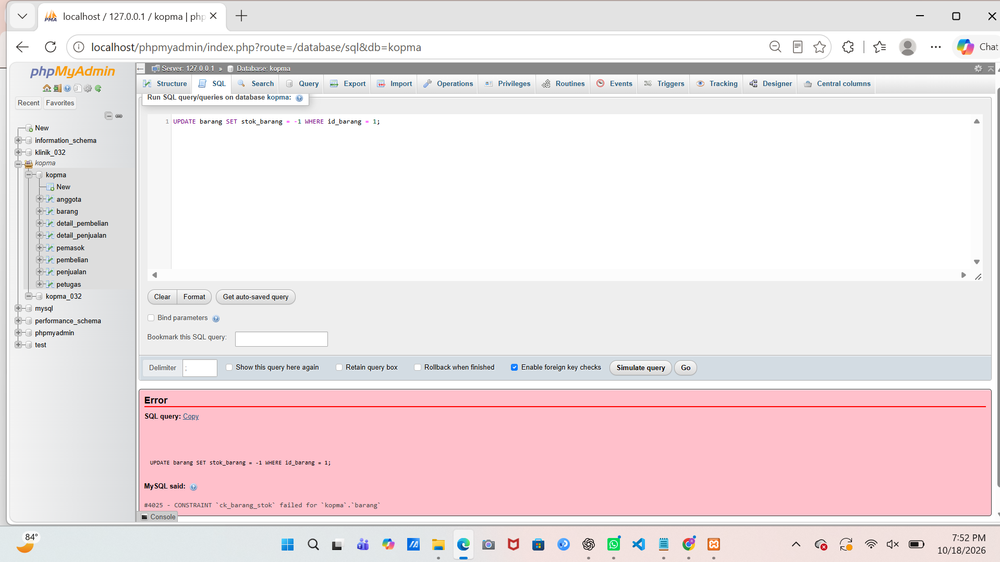

# Laporan Praktikum Basis Data - Pertemuan 05

- **Nama:** Riska Nur Jazilah
- **NIM:** 25430032
- **Kelas:** Ilmu Komputer (A)
- **Tanggal:** 18 Oktober 2026
- **Dosen:** Dedi Irawan, S.Kom., M.T.I.

## 1. Tujuan Praktikum

1. Mengubah skema relasional hasil normalisasi 3NF menjadi perintah `CREATE TABLE` dengan tipe data yang sesuai.
2. Menerapkan constraint `PRIMARY KEY`, `FOREIGN KEY`, `UNIQUE`, `NOT NULL`, `DEFAULT`, dan `CHECK` berdasarkan aturan bisnis dan integritas data.
3. Mengubah dan menghapus struktur tabel menggunakan `ALTER TABLE` dan `DROP TABLE` dengan urutan relasi yang benar.
4. Menguji bahwa constraint mampu menolak data yang tidak sesuai aturan serta membandingkan struktur fisik basis data dengan ERD.

## 2. Ringkasan Dasar Teori

Data Definition Language (DDL) digunakan untuk membuat, mengubah, dan menghapus struktur basis data melalui perintah seperti `CREATE TABLE`, `ALTER TABLE`, dan `DROP TABLE`. Pemilihan tipe data merupakan keputusan desain yang harus menyesuaikan bentuk nilai yang disimpan. Pada basis data Klinik Sehat RNJ, atribut identitas seperti `no_rekam_medis` menggunakan tipe data karakter tertentu, `tanggal_pendaftaran` menggunakan `DATE`, sedangkan atribut harga dan stok menggunakan `DECIMAL` serta `INT` untuk menjaga presisi dan keterurutan nilai.

Constraint berfungsi menjaga integritas data dengan menerapkan aturan bisnis langsung pada server basis data. `PRIMARY KEY` mengidentifikasi setiap baris secara unik, `FOREIGN KEY` menghubungkan tabel induk dan tabel anak, `UNIQUE` mencegah duplikasi nilai pada kolom tertentu, dan `NOT NULL` mewajibkan kolom memiliki isi. `DEFAULT` memberikan nilai bawaan, sedangkan `CHECK` memeriksa kondisi validitas data. Sebagai contoh, tabel `obat` menggunakan `CHECK (harga >= 0)` dan `CHECK (jumlah_stok >= 0)` untuk memastikan nilai harga dan stok tidak bernilai negatif. Tipe data `ENUM` juga digunakan untuk membatasi nilai seperti jenis kelamin atau status agar sesuai dengan pilihan yang valid.

Urutan pembuatan dan penghapusan tabel harus memperhatikan relasi kunci tamu. Tabel induk wajib dibuat terlebih dahulu sebelum tabel anak yang merujuk kepadanya, sementara proses penghapusan dilakukan secara terbalik dari tabel anak ke tabel induk. Dengan urutan yang tepat, seluruh struktur tabel dapat dikelola tanpa menimbulkan konflik relasi antartabel.

## 3. Hasil Langkah Percobaan

### D.1 Membuat Tabel Induk

Tabel induk pada basis data Kopma (yang disesuaikan menjadi `kopma_032`) dibuat terlebih dahulu tanpa mendefinisikan *foreign key*. Tabel tersebut mencakup `petugas`, `barang`, `anggota`, dan `pemasok`. Setiap tabel dilengkapi dengan `PRIMARY KEY` sebagai identitas utama baris data, serta constraint `UNIQUE` pada kolom yang nilainya harus bersifat unik.

Pemilihan tipe data disesuaikan dengan karakteristik data, seperti penggunaan `VARCHAR` dan `INT`. Constraint `CHECK` juga disematkan untuk memastikan nilai stok dan harga jual tidak bernilai negatif.

### D.2 Membuat Tabel dengan Kunci Tamu

Setelah tabel induk tersedia, tabel transaksi dibentuk dengan memerhatikan relasi ketergantungan antar tabel. Tabel transaksi tersebut meliputi `penjualan`, `detail_penjualan`, `pembelian`, dan `detail_pembelian`. Kolom *foreign key* didefinisikan dengan tipe data yang selaras dengan kolom yang dirujuk pada tabel induk.

Relasi ini memastikan integritas referensial terjaga sehingga transaksi tidak merujuk pada data master yang tidak valid. Pada tabel `detail_penjualan`, relasi dengan tabel `penjualan` menerapkan aturan `ON DELETE CASCADE` agar data detail ikut terhapus ketika transaksi utamanya dihapus.

### D.3 Membuktikan Constraint Bekerja

Pengujian constraint dilakukan guna memastikan sistem basis data secara aktif menolak input data yang melanggar aturan integritas. 

Pada pengujian yang dilakukan, sistem mendeteksi pelanggaran melalui kemunculan kode galat (*error code*):
- **Galat #1452**: Terjadi akibat pelanggaran *Foreign Key*, di mana data transaksi merujuk pada kunci induk fiktif yang tidak terdaftar.
- **Galat #1062**: Terjadi akibat pelanggaran *Unique Constraint*, di mana data dimasukkan dengan nilai duplikat pada kolom yang diatur unik.
- **Galat #4025 / Check Error**: Terjadi akibat pelanggaran *CHECK Constraint*, di mana nilai yang dimasukkan melanggar batasan kondisi logika (seperti nilai negatif pada harga atau stok).

Hasil pengujian ini membuktikan bahwa validasi integritas berjalan secara ketat di sisi server MariaDB/phpMyAdmin.

*Gambar 3.1 Tampilan verifikasi daftar tabel pada database `kopma_032`.*

*Gambar 3.2 Tampilan daftar 7 tabel pada proyek mandiri `klinik_032`.*

### D.4 Mengubah Struktur dan Membandingkan dengan ERD

Modifikasi struktur tabel dilakukan menggunakan perintah `ALTER TABLE`. Proses ini mencakup penambahan maupun penyesuaian aturan pada relasi basis data. 

Penghapusan tabel wajib memperhatikan ketergantungan *foreign key* dengan menghapus tabel anak terlebih dahulu sebelum tabel induk. Struktur fisik yang dihasilkan kemudian dicocokkan dengan perancangan ERD untuk memastikan kesesuaian nama tabel, kolom, tipe data, serta relasi kunci utama dan kunci tamu.

## 4. Jawaban Titik Analisis

### Titik Analisis 1 — ON DELETE CASCADE

`ON DELETE CASCADE` diterapkan pada tabel detail transaksi (seperti `detail_resep` atau `detail_penjualan`) karena baris detail merupakan bagian utuh yang bergantung pada transaksi utamanya. Apabila transaksi induk dihapus, data detail yang menyertainya ikut dibersihkan agar tidak menjadi data yatim (*orphaned data*). Sebaliknya, relasi ke tabel master tertentu tidak menggunakan `CASCADE` secara bebas agar data master yang masih direferensikan tidak terhapus sembarangan yang dapat merusak riwayat laporan.

### Titik Analisis 2 — Pemetaan Kode Galat ke Aturan Bisnis

- **Error 1452 (`FOREIGN KEY`):** Terjadi saat memasukkan data anak yang mereferensikan kunci induk tidak terdaftar. Berfungsi menjaga integritas referensial antar tabel.
- **Error 4025 (`CHECK`):** Terjadi saat nilai yang dimasukkan melanggar kondisi batasan logika, misalnya nilai negatif pada atribut angka yang harus bernilai positif.
- **Error 1062 (`UNIQUE`):** Terjadi saat memasukkan nilai kembar pada kolom yang wajib unik. Berfungsi mencegah duplikasi identitas data.

Ketiga kode galat tersebut menunjukkan bahwa MariaDB menolak operasi tulis yang melanggar batasan rancangan tabel.

### Titik Analisis 3 — Urutan DROP TABLE

Tabel yang memiliki *foreign key* harus dihapus terlebih dahulu sebelum tabel induk yang dirujuknya. Jika tabel induk dihapus lebih awal, DBMS akan menolak perintah tersebut guna mencegah rusaknya integritas referensial. Urutan penghapusan yang benar dimulai dari tabel transaksi/detail terluar hingga menuju tabel master induk.

## 5. Hasil Latihan dan Modifikasi

### E.1 — Constraint CHECK untuk Validasi Data

Penerapan constraint `CHECK` pada tabel proyek mandiri (seperti validasi harga obat dan jumlah stok) memastikan bahwa atribut numerik krusial tidak boleh bernilai negatif. Ketika diuji dengan memasukkan nilai negatif, MariaDB secara otomatis menolak perintah tersebut dan mengeluarkan galat. Pengujian ini mengonfirmasi bahwa aturan validasi diterapkan langsung pada struktur basis data.

*Gambar 5.1 Bukti penolakan input bernilai negatif akibat pelanggaran CHECK Constraint.*

### E.2 — Integrasi Relasi dan Validasi Integritas

Pengaturan relasi tabel menggunakan *foreign key* dan opsi cascade memastikan bahwa hubungan antar tabel master dan transaksional pada proyek Klinik Sehat RNJ berjalan selaras. Validasi ini membantu menjaga agar seluruh transaksi memiliki catatan referensi pasien dan tenaga kesehatan yang valid.

## 6. Tugas Mandiri: Milestone Proyek 5 (Klinik Sehat RNJ)

### 6.1 Daftar Tabel dan Constraint

Proyek mandiri Klinik Sehat RNJ menggunakan basis data `klinik_032` dengan tujuh tabel hasil normalisasi 3NF, yaitu `pasien`, `tenaga_kesehatan`, `obat`, `kunjungan`, `pemeriksaan`, `resep`, dan `detail_resep`. Setiap tabel dilengkapi dengan `PRIMARY KEY` serta constraint pendukung seperti `UNIQUE`, `FOREIGN KEY`, `NOT NULL`, `DEFAULT`, `ENUM`, dan `CHECK`.

| Tabel | Constraint Utama | Aturan Bisnis / Fungsi Terkait |
|---|---|---|
| `pasien` | `PRIMARY KEY` (`no_rekam_medis`), `UNIQUE` (`NIK`, `no_Hp`), `NOT NULL` | Menyimpan identitas unik pasien, mencegah duplikasi NIK dan nomor kontak. |
| `tenaga_kesehatan` | `PRIMARY KEY` (`id_tenaga_kesehatan`), `UNIQUE` (`no_Hp`), `NOT NULL` | Menyimpan data tenaga medis yang melayani kunjungan. |
| `obat` | `PRIMARY KEY` (`id_obat`), `CHECK` (`harga >= 0`, `jumlah_stok >= 0`) | Mengelola inventaris obat dan mencegah nilai negatif pada harga dan stok. |
| `kunjungan` | `PRIMARY KEY` (`id_kunjungan`), `FOREIGN KEY` (`no_rekam_medis`, `id_tenaga_kesehatan`) | Mencatat transaksi kunjungan pasien dengan referensi ke tabel pasien dan nakes. |
| `pemeriksaan` | `PRIMARY KEY` (`id_pemeriksaan`), `FOREIGN KEY` (`id_kunjungan`) | Menyimpan hasil diagnosis medis yang terikat pada satu kunjungan. |
| `resep` | `PRIMARY KEY` (`id_resep`), `FOREIGN KEY` (`id_pemeriksaan`) | Mencatat resep obat berdasarkan hasil pemeriksaan medis. |
| `detail_resep` | `PRIMARY KEY` (`id_resep`, `id_obat`), `CHECK` (`jumlah > 0`), `FOREIGN KEY` | Menghubungkan resep dengan obat spesifik serta membatasi jumlah obat agar lebih dari nol. |

### 6.2 ERD Fisik dan Pemetaan Struktur

ERD fisik Klinik Sehat RNJ menggambarkan relasi antar tujuh tabel dengan batasan kunci utama dan kunci tamu yang jelas. Tabel master (`pasien`, `tenaga_kesehatan`, `obat`) menjadi acuan bagi tabel transaksional (`kunjungan`, `pemeriksaan`, `resep`, `detail_resep`). Pemetaan tipe data disesuaikan dengan jenis informasi yang disimpan, seperti `VARCHAR` untuk teks, `DATE`/`DATETIME` untuk waktu, `DECIMAL` untuk nilai mata uang, serta `ENUM` untuk pilihan status yang terbatas.

### 6.3 Pengujian Constraint Proyek

Pengujian error handling pada basis data `klinik_032` menghasilkan bukti tangkapan layar penolakan sistem terhadap data yang tidak valid:

*Gambar 6.1 Bukti penolakan sistem pada pelanggaran Foreign Key (Galat #1452).*

*Gambar 6.2 Bukti penolakan sistem pada pelanggaran Unique Constraint (Galat #1062).*

*Gambar 6.3 Bukti penolakan sistem pada pelanggaran CHECK Constraint (Galat #4025).*

## 7. Pembahasan dan Kendala

Praktikum Modul 05 membuktikan bahwa perancangan skema relasional 3NF harus diterjemahkan secara presisi ke dalam perintah DDL MySQL/MariaDB. Pemilihan tipe data yang tepat serta penerapan constraint terbukti efektif dalam menjaga kualitas dan keabsahan data di dalam server. 

Kendala kecil pada penamaan database awal (`kopma` menjadi `kopma_032`) berhasil diselesaikan dengan aman tanpa menghilangkan struktur tabel yang telah dibuat sebelumnya. Pengujian galat juga mengonfirmasi bahwa aturan integritas data bekerja secara aktif menolak input yang menyimpang dari ketentuan bisnis.

## 8. Kesimpulan

1. Perintah DDL berhasil diimplementasikan untuk membangun dan mengelola struktur basis data `kopma_032` serta proyek mandiri `klinik_032`.
2. Penerapan komponen constraint (`PRIMARY KEY`, `FOREIGN KEY`, `UNIQUE`, `CHECK`, `NOT NULL`) terbukti sukses menjaga konsistensi integritas data relasional.
3. Pengujian penanganan kesalahan menunjukkan bahwa MariaDB secara konsisten menolak pelanggaran aturan data melalui kemunculan galat sistem (#1452, #1062, dan #4025).

## 9. Pernyataan Penggunaan AI

Dalam penyusunan laporan, penulisan sintaks DDL, dan pemahaman konsep *error handling* pada Modul 05 ini, praktikan memanfaatkan teknologi AI yaitu **Claude** dan **Gemini** sebagai asisten kolaborasi belajar untuk membantu menyusun struktur laporan, merumuskan skema tabel, serta memperjelas konsep basis data. Seluruh eksekusi perintah SQL, pengambilan tangkapan layar (*screenshot*), serta verifikasi akhir dilakukan secara mandiri oleh praktikan pada server lokal phpMyAdmin.

## 10. Bukti Git

- **Repositori GitHub:** `https://github.com/rnurjazilah-cyber/basisdata-032`

## Checklist

| Status | Jenis | Yang harus ada |
|---|---|---|
| [✓] | Berkas wajib | Script DDL `p05_ddl_25430032.sql` dan struktur tabel terverifikasi |
| [✓] | Bukti tangkapan layar | `p05_kopma_show_tables.png`, `p05_klinik_show_tables.png`, `p05_galat_1452.png`, `p05_galat_1062.png`, `p05_galat_4025.png`, dan `p05_error_check.png` |
| [✓] | Analisis wajib | Penjelasan tipe data, penerapan constraint, dan pengujian error handling |