# Laporan Praktikum Basis Data - Pertemuan 06

**Nama:** Riska Nur Jazilah    **NIM:** 25430032    **Kelas:** A    **Tanggal:** 31 Oktober 
## 1. Tujuan Praktikum

Pada pertemuan ini saya mengisi tabel Kopma yang dibuat pada Pertemuan 5 dengan data sampel, lalu mengubah dan menghapus data dengan aman. Saya juga menguji constraint dengan skenario uji yang mencatat masukan, hasil yang diharapkan, hasil nyata, dan status, termasuk satu uji yang memang diperkirakan gagal. Hasilnya diterapkan juga pada proyek Klinik Sehat RNJ dengan data berbasis parameter P.

## 2. Ringkasan Dasar Teori

Data diisi dari tabel induk dulu baru tabel anak, supaya kunci tamu tidak menolak baris anak. `INSERT ... SELECT` dipakai untuk menyalin nilai dari tabel lain, misalnya harga barang ke detail nota, sehingga tidak ada salah ketik. `UPDATE` dan `DELETE` harus memakai `WHERE`, dan mode aman (`sql_safe_updates`) menolak perintah yang tidak memakai kolom kunci supaya tidak mengubah seluruh tabel tanpa sengaja. Aturan hapus kunci tamu menentukan apa yang terjadi pada baris anak: `CASCADE` ikut menghapus, `RESTRICT` menolak. Skenario uji dicatat dengan hasil nyata, bukan perkiraan, supaya kelemahan desain bisa terlihat, misalnya aturan yang melibatkan dua tabel tidak bisa dijaga oleh `CHECK`.

## 3. Hasil Langkah Percobaan

### 3.1 Praktikum Kopma (`kopma_032`)

Data sampel diisi dengan `p06_data_kopma_25430032.sql`. Jumlah baris: petugas 5, anggota 3, barang 4, pemasok 2, penjualan 2, detail_penjualan 4.

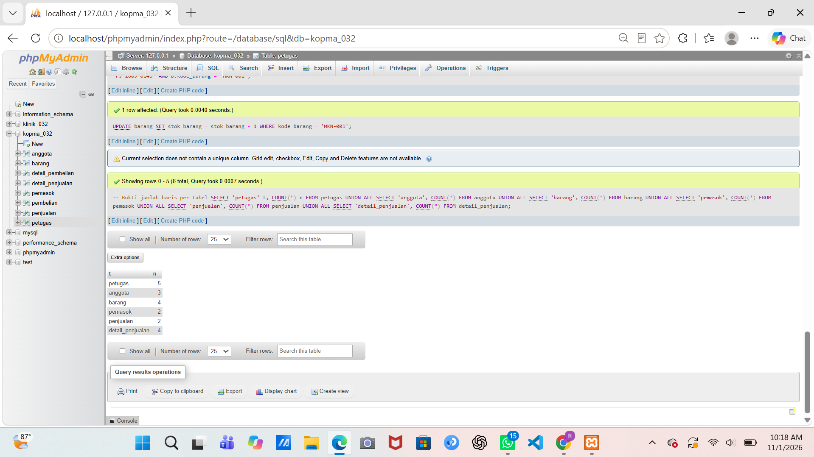
*Jumlah baris per tabel Kopma setelah data diisi.*

Sembilan skenario uji (UJ-01 sampai UJ-09) tercatat di `p06_uji_kopma_25430032.md`: delapan sesuai harapan, satu (UJ-09) gagal sesuai prediksi.

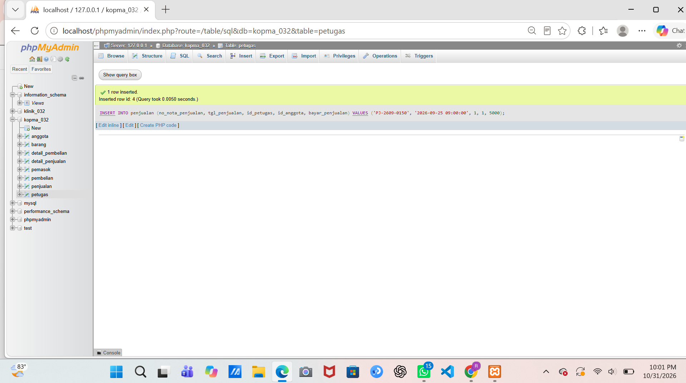
*UJ-01: nota untuk anggota aktif diterima (AB-02).*

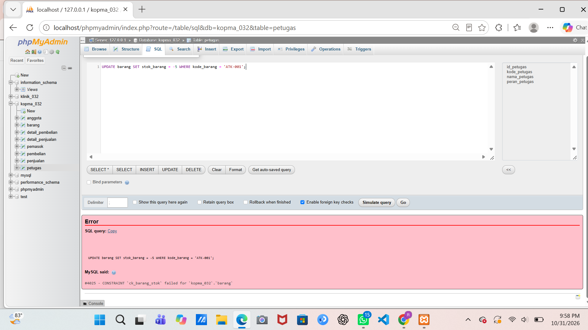
*UJ-03: stok -5 ditolak oleh CHECK, ERROR 4025 (AB-03).*


*UJ-04: nomor nota kembar ditolak, ERROR 1062 (AB-01).*


*UJ-08: UPDATE tanpa WHERE ditolak mode aman, ERROR 1175.*

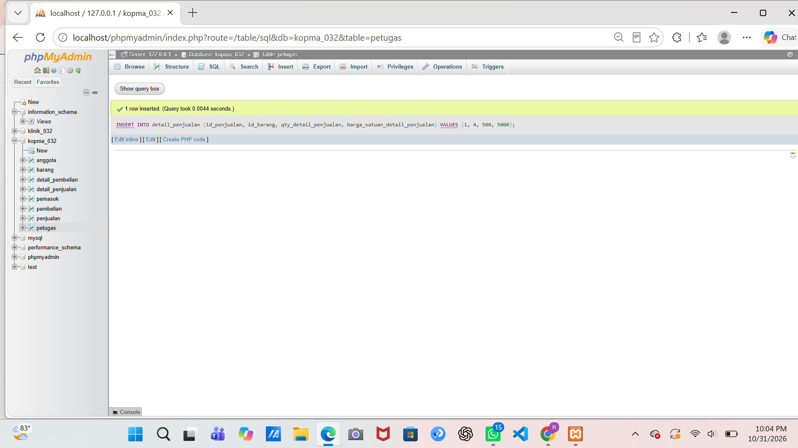
*UJ-09: detail dengan qty 500 padahal stok roti 5 tetap diterima, sehingga AB-03 belum terjaga.*

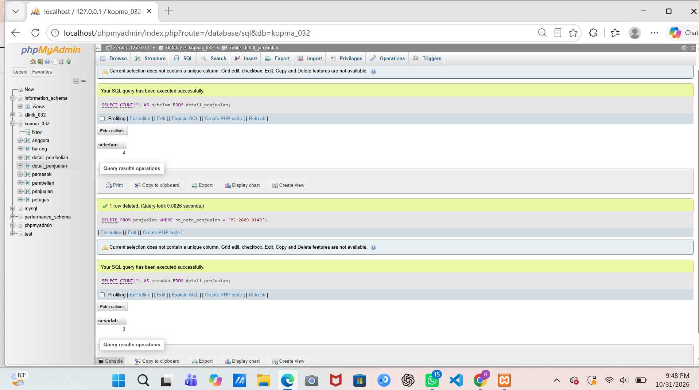
*Menghapus nota PJ-2609-0143: jumlah detail penjualan berkurang dari 4 menjadi 3.*

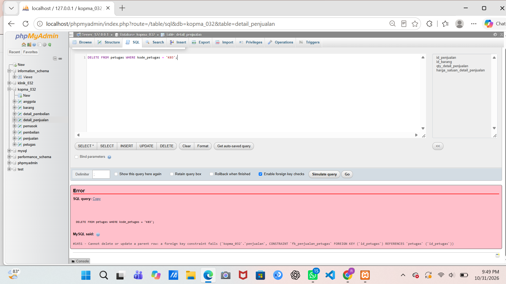
*Menghapus petugas K03 yang pernah melayani nota ditolak, ERROR 1451.*

### 3.2 Perbaikan aturan hapus

Hasil query `information_schema.referential_constraints` menunjukkan `fk_dpenjualan_penjualan` dan `fk_dpembelian_pembelian` bernilai RESTRICT, sehingga nota tidak bisa dihapus selama detailnya ada. Keduanya saya ubah menjadi `ON DELETE CASCADE` dengan `ALTER TABLE`.

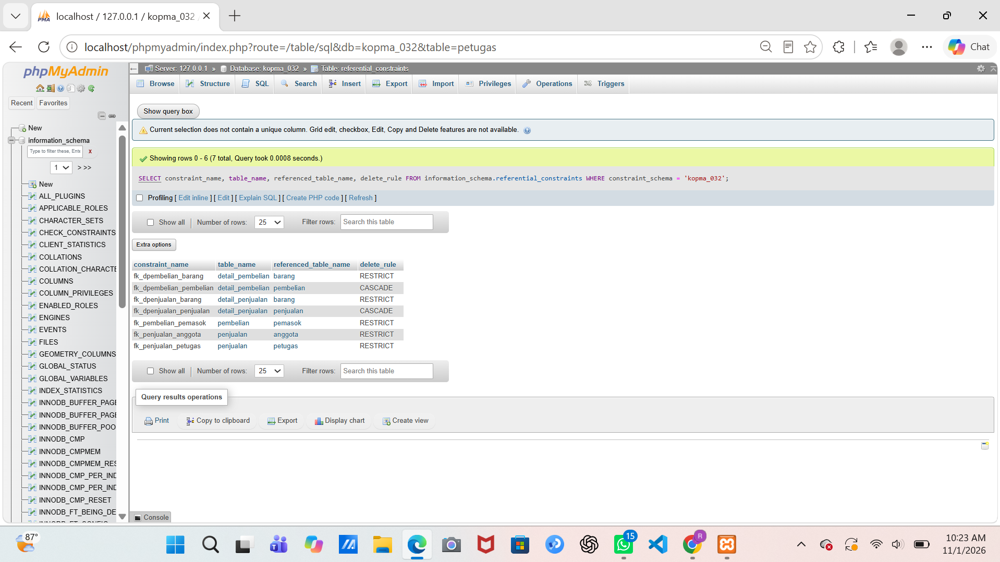
*Hasil perbaikan constraint menjadi CASCADE.*

## 4. Jawaban Titik Analisis

**Titik Analisis 1.** Harga satuan diambil langsung dari tabel `barang` lewat `INSERT ... SELECT`, sehingga tidak ada salah ketik. Harga itu disalin ke `harga_satuan_detail_penjualan`, jadi kalau harga barang naik, nota yang lama tidak ikut berubah (AB-04).

**Titik Analisis 2.** Detail ikut terhapus bersama nota karena `fk_dpenjualan_penjualan` memakai `ON DELETE CASCADE`: detail tidak punya arti tanpa nota induknya. Petugas tidak ikut terhapus karena `fk_penjualan_petugas` tidak memakai CASCADE, sehingga petugas yang pernah melayani nota tidak bisa dihapus dan riwayat penjualan terjaga. Petugas yang berhenti sebaiknya dinonaktifkan, bukan dihapus.

**Titik Analisis 3.** UJ-09 diperkirakan gagal karena aturan AB-03 (penjualan ditolak jika jumlah melebihi stok) melibatkan dua tabel, yaitu `detail_penjualan` dan `barang`, sedangkan `CHECK` hanya menjaga nilai pada satu baris. Tanpa transaksi atau trigger, server tidak bisa membandingkannya, dan itu menjadi utang desain untuk Modul 14.

## 5. Hasil Latihan dan Modifikasi

**Latihan E.1: pengarsipan anggota nonaktif yang mendaftar sebelum 2025.**

```sql
DROP TABLE IF EXISTS anggota_arsip;
CREATE TABLE anggota_arsip LIKE anggota;

INSERT INTO anggota_arsip
SELECT * FROM anggota a
WHERE a.status_anggota = 'nonaktif' AND a.tgl_daftar_anggota < '2025-01-01'
  AND NOT EXISTS (SELECT 1 FROM penjualan p WHERE p.id_anggota = a.id_anggota);

DELETE FROM anggota WHERE id_anggota IN (SELECT id_anggota FROM anggota_arsip);

SELECT no_anggota, status_anggota FROM anggota_arsip;
SELECT no_anggota, status_anggota FROM anggota;
```

Hasil nyata: anggota A-0459 (nonaktif, mendaftar 2024-08-20, tidak punya nota) pindah ke `anggota_arsip`, sedangkan A-0457 dan A-0458 tetap di `anggota`. Kondisi `NOT EXISTS` memastikan anggota yang pernah punya nota tidak ikut diarsipkan.

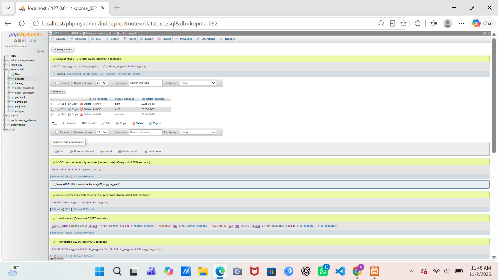
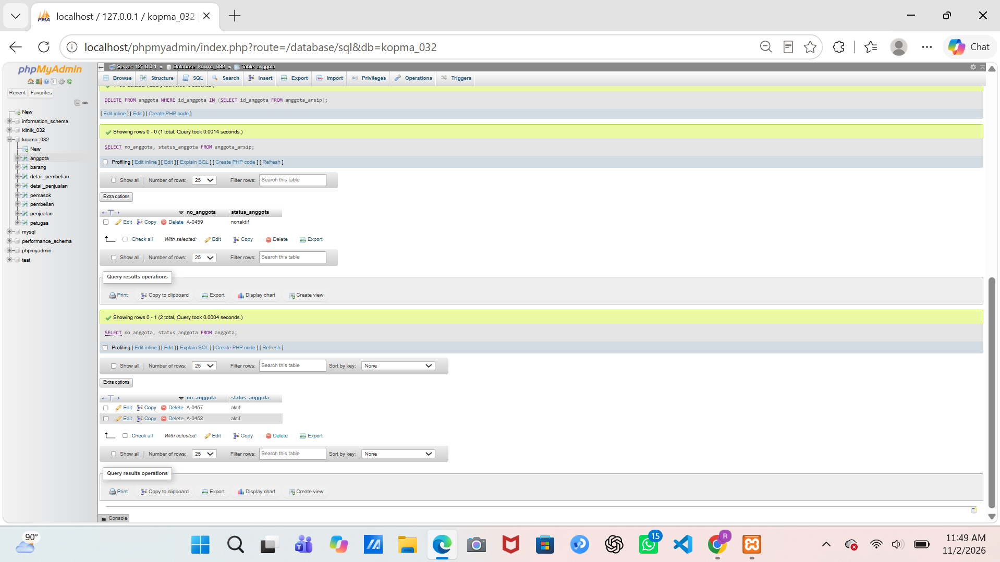
*Pengarsipan anggota nonaktif: `1 row inserted`, `1 row deleted`, lalu isi `anggota_arsip` dan `anggota`.*

**Latihan E.2: kenaikan harga makanan 5% dibulatkan ke ratusan.**

```sql
SET SESSION sql_safe_updates = 1;
UPDATE barang SET harga_jual_barang = ROUND(harga_jual_barang * 1.05, -2)
WHERE kategori_barang = 'makanan' AND id_barang > 0;
```

Hasil nyata: `1 row affected`. Harga Roti Cokelat (`MKN-001`) berubah dari 5000.00 menjadi 5300.00 (5000 × 1,05 = 5250, dibulatkan ke ratusan terdekat menjadi 5300). Syarat `id_barang > 0` dipakai agar perintah diterima mode aman.

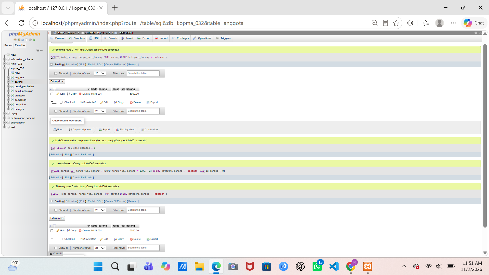
*Harga makanan sebelum (5000.00) dan sesudah (5300.00).*

Setelah latihan, `p06_data_kopma_25430032.sql` dijalankan ulang agar data kembali ke kondisi awal.

## 6. Tugas Mandiri: Milestone Proyek 6

Proyek: Klinik Sehat RNJ (`klinik_032`). Parameter P = 6, sesuai dokumen kebutuhan data Pertemuan 2: (32 mod 9) + 1 = 6. Tabel transaksi utama harus memuat minimal 10 × P = 60 baris pada minimal 3 tanggal berbeda.

**Berkas:** `p06_data_25430032.sql` dan `p06_uji_25430032.md`.

**Keputusan desain:**
- Transaksi utama adalah `kunjungan`: 60 baris pada 5 tanggal (26–30 Oktober 2026), 12 kunjungan per hari. Setiap kunjungan punya satu pemeriksaan (60 baris), resep dibuat untuk 53 pemeriksaan (kontrol rutin tidak diberi resep), dengan 68 baris detail resep.
- Setiap resep berisi satu atau dua jenis obat. Jumlah itu di bawah batas maksimal P + 2 = 8 item per transaksi yang saya tetapkan di dokumen kebutuhan data.
- Data induk: 12 pasien, 6 tenaga kesehatan, 8 obat.
- Skrip diawali `TRUNCATE`, sehingga bisa dijalankan ulang dengan hasil yang sama.
- Data diisi dengan id eksplisit dan pola berulang (`ELT`) agar keluhan, diagnosis, dan obat tetap masuk akal dan tidak berisi teks asal-asalan.

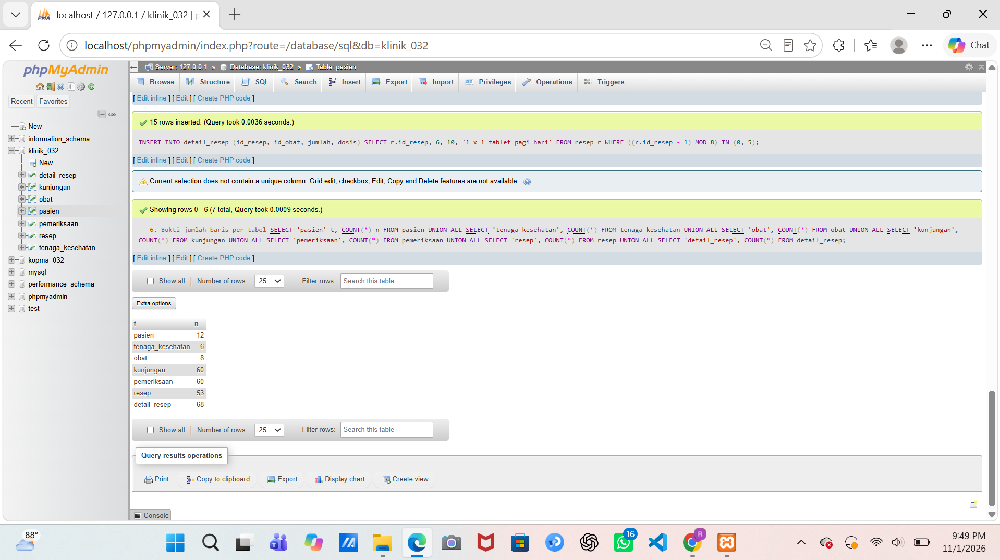
*Jumlah baris per tabel klinik: pasien 12, tenaga_kesehatan 6, obat 8, kunjungan 60, pemeriksaan 60, resep 53, detail_resep 68.*

**Sepuluh skenario uji** (rincian di `p06_uji_25430032.md`): 2 uji positif (UP01–UP02), 7 uji negatif (UN01–UN07), dan 1 uji gagal (UG01).


*UP01: kunjungan baru untuk pasien yang ada diterima (AB-02).*

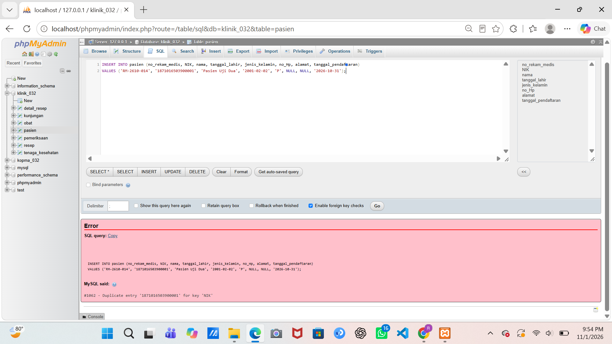
*UN01: NIK yang sudah dipakai ditolak, ERROR 1062.*


*UN02: nomor HP yang sudah dipakai ditolak, ERROR 1062.*

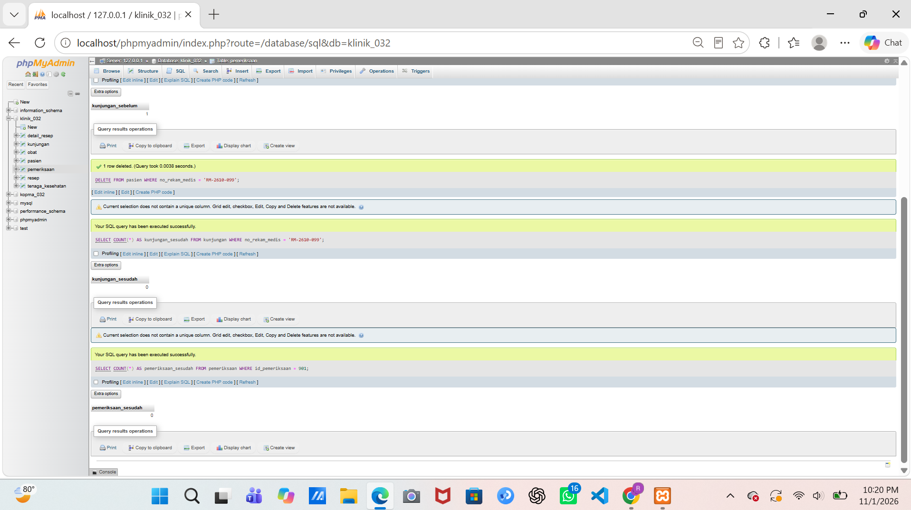
*UG01: menghapus pasien diterima, dan kunjungan serta pemeriksaannya ikut terhapus.*

**Utang desain:** semua kunci tamu di `klinik_032` berupa `ON DELETE CASCADE`, sehingga menghapus pasien atau tenaga kesehatan menghilangkan seluruh riwayat medisnya. Ini bertentangan dengan kebutuhan non-fungsional di dokumen Pertemuan 2 bahwa data kunjungan dirancang disimpan minimal 5 tahun. Rencana perbaikan di Modul 14: ubah menjadi RESTRICT atau tambahkan status nonaktif. Stok obat juga belum berkurang otomatis ketika resep dibuat, padahal AB-07 mensyaratkan obat hanya diberikan jika stok mencukupi.

## 7. Pembahasan dan Kendala

1. **ERROR 1701 saat `TRUNCATE`.** Kotak "Enable foreign key checks" di phpMyAdmin masih tercentang, sehingga `SET FOREIGN_KEY_CHECKS = 0` pada skrip tidak berlaku. Saya mematikan centang itu sebelum menjalankan skrip.
2. **ERROR 1451 saat menghapus nota.** Aturan hapus `fk_dpenjualan_penjualan` ternyata RESTRICT. Saya periksa lewat `information_schema.referential_constraints`, lalu mengubahnya menjadi CASCADE dengan `ALTER TABLE ... DROP FOREIGN KEY` dan `ADD CONSTRAINT`.
3. **Query tercampur.** Kotak SQL masih berisi sisa query sebelumnya, sehingga phpMyAdmin menjalankan query lain (ERROR 1109). Saya menekan Clear sebelum menempel query baru.
4. **Mencocokkan nama kolom.** Sebelum menulis skrip data, saya memeriksa kolom setiap tabel lewat `information_schema.columns` agar skrip tidak error.
5. **Tangkapan layar terlalu kecil.** Hasil yang panjang membuat tulisan tidak terbaca. Saya memperbesar tampilan browser dan mengambil dua tangkapan layar bila perlu.

## 8. Kesimpulan

Constraint di server menolak data yang salah sebelum masuk ke tabel, tetapi tidak semua aturan bisnis bisa dijaga dengan `CHECK`, seperti aturan jumlah penjualan terhadap stok. Aturan hapus kunci tamu perlu dipilih sesuai jenis data: `CASCADE` cocok untuk detail nota, tetapi berbahaya untuk riwayat medis. Skenario uji yang mencatat hasil nyata membantu menemukan kelemahan itu lebih awal.

## 9. Pernyataan Penggunaan AI

Saya menggunakan Claude (Anthropic) untuk membantu menyusun skrip data, kerangka skenario uji, dan kerangka laporan, serta menjelaskan pesan galat dan langkah pemeriksaan di phpMyAdmin. Semua perintah saya jalankan sendiri di phpMyAdmin, dan hasil nyata serta tangkapan layar berasal dari komputer saya. Jawaban dan penjelasan saya baca, cocokkan dengan hasil uji, dan sesuaikan sebelum dikumpulkan.

## 10. Bukti Git

- Repositori: https://github.com/rnurjazilah-cyber/basisdata-032

| Commit | Pesan | Hash |
|---|---|---|
| Data dan uji Kopma | `p06: data dan uji kopma` | `<82e28c3>` |
| Data dan uji klinik | `p06: data dan uji klinik` | `<0273a07>` |
| Laporan | `p06: laporan` | `<9ec38de>` |

## Checklist

### Checklist khusus Pertemuan 6

| Status | Jenis | Yang harus ada |
|---|---|---|
| [√] | Berkas wajib | `p06_data_25430032.sql` (data sampel berbasis parameter P) dan `p06_uji_25430032.md` (skenario uji) |
| [√] | Bukti tangkapan layar | Hasil skenario uji positif dan negatif; jumlah baris per tabel |
| [√] | Analisis wajib | Tabel skenario uji: masukan, hasil yang diharapkan, hasil nyata, status |

### Checklist umum

| Status | Butir | Yang harus ada |
|---|---|---|
| [√] | Identitas | Nama, NIM, kelas, pertemuan ke-6, tanggal pelaksanaan, nama asisten/dosen |
| [√] | Tujuan | Tujuan praktikum ditulis ulang dengan bahasa sendiri (maksimal 5 baris) |
| [√] | Ringkasan teori | Pemahaman sendiri atas Dasar Teori, maksimal setengah halaman |
| [√] | Langkah percobaan (D) | Tangkapan layar hasil langkah kunci, masing-masing diberi keterangan singkat |
| [√] | Titik Analisis | Semua Titik Analisis dijawab lengkap dengan alasan |
| [√] | Latihan (E) | Skrip hasil latihan beserta bukti berjalan |
| [√] | Tugas Mandiri (F) | Milestone proyek: berkas, bukti, dan penjelasan keputusan desain |
| [√] | Pembahasan dan kendala | Galat yang ditemui, cara membacanya, dan cara mengatasinya |
| [√] | Kesimpulan | Dua sampai empat kalimat dengan bahasa sendiri |
| [√] | Pernyataan Penggunaan AI | Alat yang dipakai, untuk apa, dan bagian mana |
| [√] | Bukti Git | Tautan repositori dan kode commit (hash) pertemuan ini |
| [√] | Keaslian | Setiap tangkapan layar memperlihatkan akun ber-NIM dan jam sistem |
