# Laporan Praktikum Basis Data - Pertemuan 07

**Nama:** Riska Nur Jazilah    **NIM:** 25430032    **Kelas:** A    

## 1. Tujuan Praktikum

Pada pertemuan ini saya belajar menulis kueri `SELECT` satu tabel untuk menjawab kebutuhan informasi (KI) dari Pertemuan 2. Saya memakai penyaringan (`WHERE`, `IN`, `BETWEEN`, `LIKE`, `IS NULL`) dan fungsi skalar (teks, tanggal, `CASE`), memahami urutan evaluasi `SELECT`, dan membedakan kueri yang salah sintaks dengan yang salah makna. Hasilnya saya terapkan pada Kopma dan pada proyek Klinik Sehat RNJ.

## 2. Ringkasan Dasar Teori

Kueri `SELECT` dievaluasi dengan urutan `FROM`, `WHERE`, `SELECT`, `ORDER BY`. Akibatnya alias yang dibuat di `SELECT` tidak dikenal di `WHERE`, tetapi dikenal di `ORDER BY`. `NULL` berarti nilai tidak diketahui, sehingga perbandingan dengan `=` menghasilkan UNKNOWN dan baris tidak lolos; nilai kosong harus diperiksa dengan `IS NULL`. `AND` dievaluasi lebih dulu daripada `OR`, sehingga syarat campuran perlu tanda kurung. Kolom `DATETIME` yang dibandingkan dengan tanggal tanpa jam dibaca sebagai pukul 00.00, jadi batas akhir rentang harus ditulis lengkap atau memakai batas "kurang dari hari berikutnya". Fungsi skalar bekerja per baris (satu baris masuk, satu nilai keluar), sedangkan menggabungkan banyak baris membutuhkan fungsi agregat yang dipelajari di Pertemuan 9.

## 3. Hasil Langkah Percobaan (Kopma, `kopma_032`)

Semua kueri langkah D tertulis di `p07_kueri_kopma_25430032.sql`, masing-masing dengan komentar pertanyaan dan harapan.

**D.1 Penyaringan.** Kueri KI-03 menampilkan barang di bawah stok minimum. Hasilnya satu baris, roti cokelat (stok 5, batas 10, kurang 5).

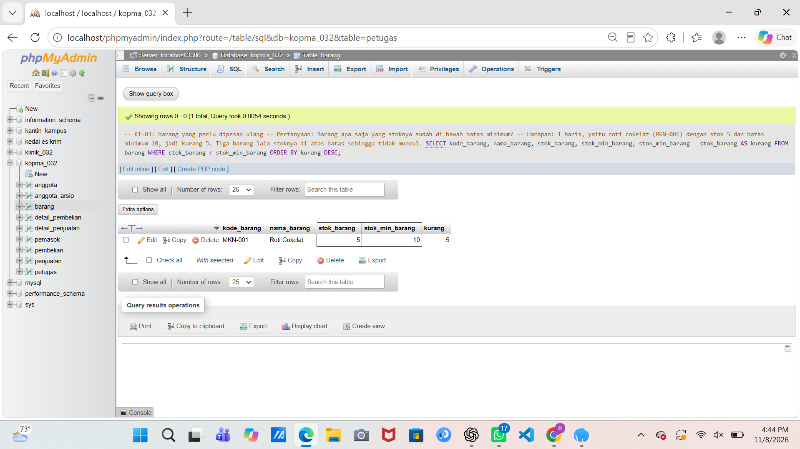
*Q1: barang yang stoknya di bawah batas minimum.*

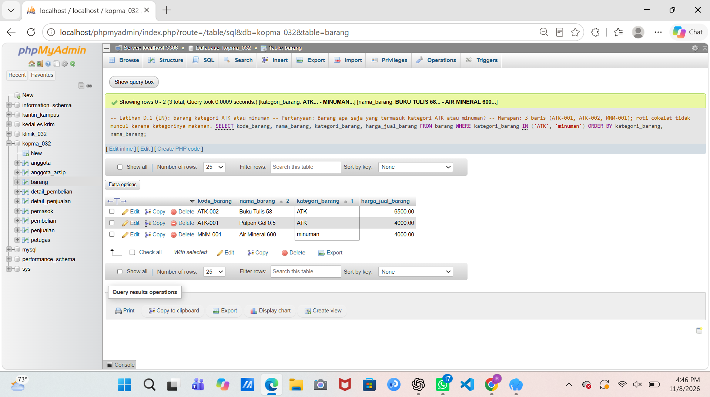
*Q2: `IN` untuk barang kategori ATK atau minuman (3 baris).*

*Q3: `BETWEEN` untuk nota tanggal 24 September 2026 (2 nota).*

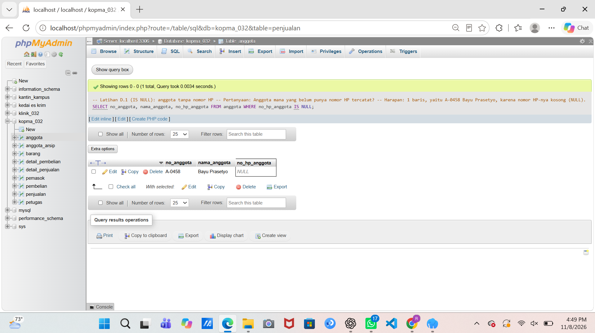
*Q4: `IS NULL` untuk anggota tanpa nomor HP (A-0458).*

**D.2 Pola teks dan nilai kosong.**

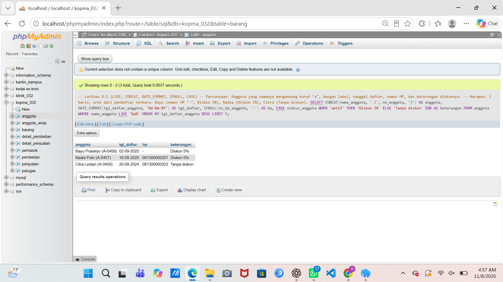
*Q5: `LIKE`, `CONCAT`, `DATE_FORMAT`, `IFNULL`, dan `CASE` pada data anggota.*

**D.3 Tanggal dan perhitungan per baris.**

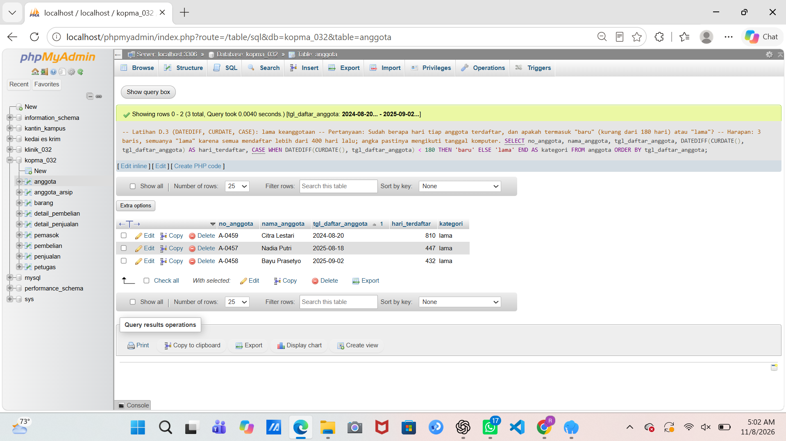
*Q6: `DATEDIFF`, `CURDATE`, dan `CASE` untuk lama keanggotaan.*

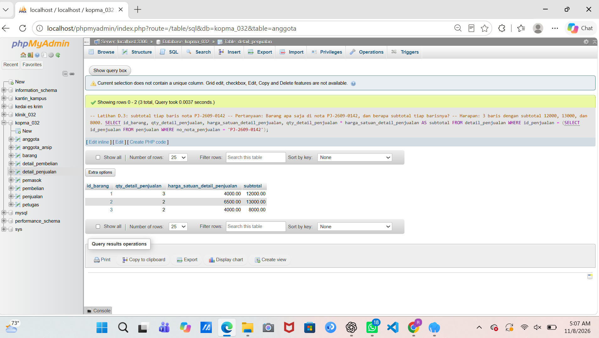
*Q7: subtotal tiap baris nota PJ-2609-0142.*

## 4. Jawaban Titik Analisis

**Titik Analisis 1: alias di `WHERE`.** Kueri `WHERE kurang > 0` menghasilkan galat `1054 Unknown column 'kurang' in 'where clause'`. Penyebabnya urutan evaluasi: `WHERE` dijalankan sebelum `SELECT`, sedangkan alias `kurang` baru dibuat di `SELECT`, jadi saat `WHERE` dievaluasi nama itu belum ada. Perbaikannya mengulang ekspresi `stok_min_barang - stok_barang > 0` di `WHERE`, dan hasilnya sama dengan Q1. Alias bisa dipakai di `ORDER BY` karena klausa itu dievaluasi sesudah `SELECT`.

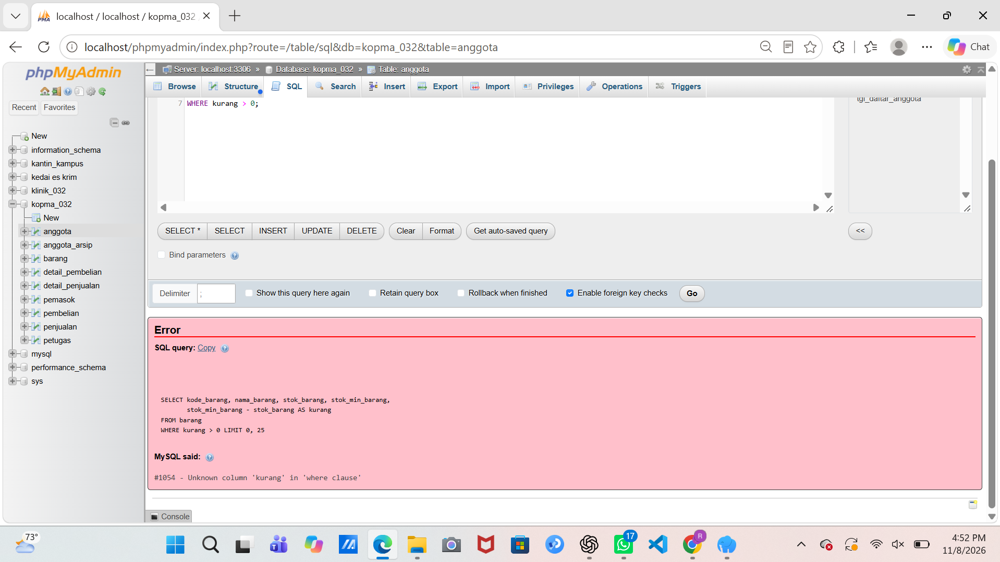
*Galat 1054 saat alias dipakai di `WHERE`.*

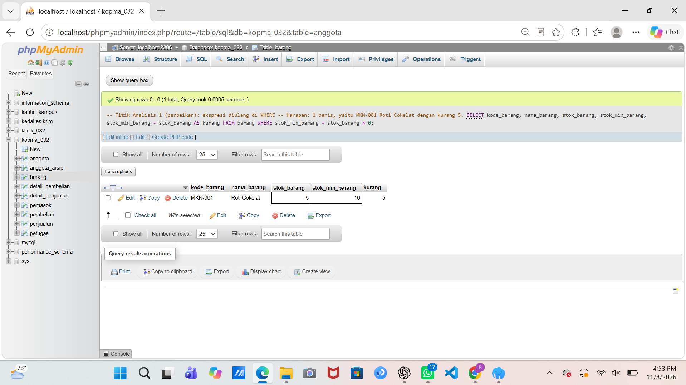
*Perbaikan dengan mengulang ekspresi di `WHERE`.*

**Titik Analisis 2: `= NULL` melawan `IS NULL`.** `WHERE no_hp_anggota = NULL` tidak mengembalikan baris meskipun ada anggota tanpa nomor HP. `NULL` berarti nilai tidak diketahui, sehingga perbandingan apa pun dengan `NULL` hasilnya UNKNOWN (bukan benar), dan `WHERE` hanya meloloskan baris yang benar. `IS NULL` adalah cara yang benar untuk memeriksa nilai kosong. `NULL` juga berbeda dari string kosong `''`: string kosong adalah nilai teks yang panjangnya nol, sedangkan `NULL` berarti tidak ada nilai, sehingga `IS NULL` tidak menangkap `''`.

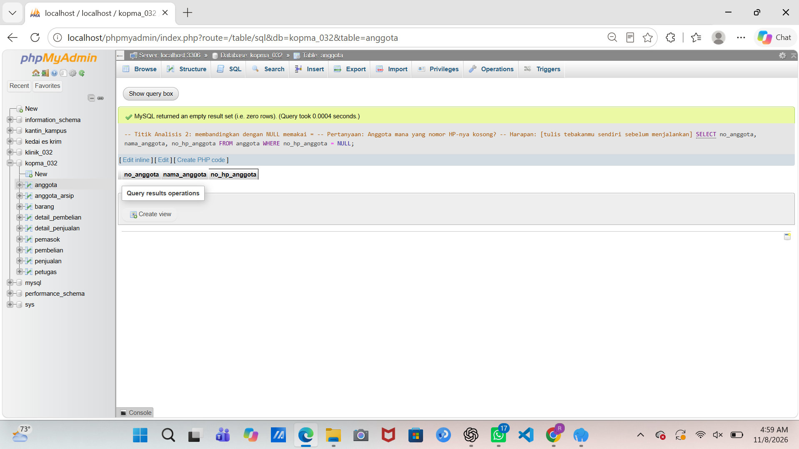
*`= NULL` tidak mengembalikan baris. Versi benar dengan `IS NULL` ada pada Q4.*

**Titik Analisis 3: subtotal bisa, total belum.** Subtotal tiap baris nota dapat dihitung dengan kueri biasa karena fungsi skalar bekerja per baris: satu baris masuk, satu nilai keluar. Total nota berarti menjumlahkan banyak baris menjadi satu angka, dan itu membutuhkan fungsi agregat `SUM` bersama `GROUP BY` untuk mengelompokkan per nota. Keduanya dipelajari di Pertemuan 9.

## 5. Hasil Latihan dan Modifikasi

**Latihan E.1: huruf kapital dan format Rupiah.** Kueri memakai `UPPER` dan `FORMAT(harga_jual_barang, 0, 'id_ID')`, sehingga nama barang tampil huruf kapital dan harga berformat titik ribuan seperti `Rp4.000`.

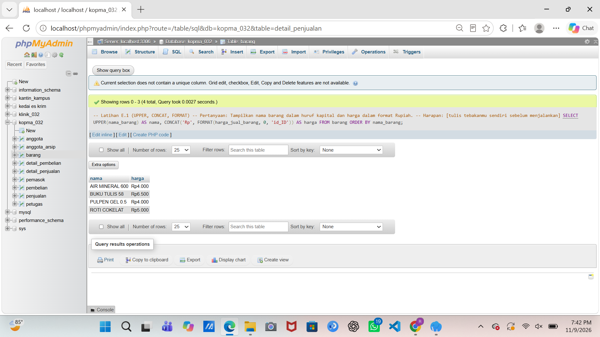
*Nama barang huruf kapital dan harga berformat Rupiah.*

**Latihan E.2: kueri salah semantik tetapi tetap berjalan.** Kueri `WHERE kategori_barang = 'ATK' OR kategori_barang = 'minuman' AND stok_barang < 50` berjalan tanpa galat tetapi memberi hasil yang keliru: `AND` dievaluasi lebih dulu, sehingga syaratnya terbaca "semua ATK, atau minuman dengan stok di bawah 50". Dua barang ATK ikut muncul padahal stoknya di atas 50. Perbaikannya memberi tanda kurung: `(kategori_barang = 'ATK' OR kategori_barang = 'minuman') AND stok_barang < 50`, dan hasilnya hanya air mineral.

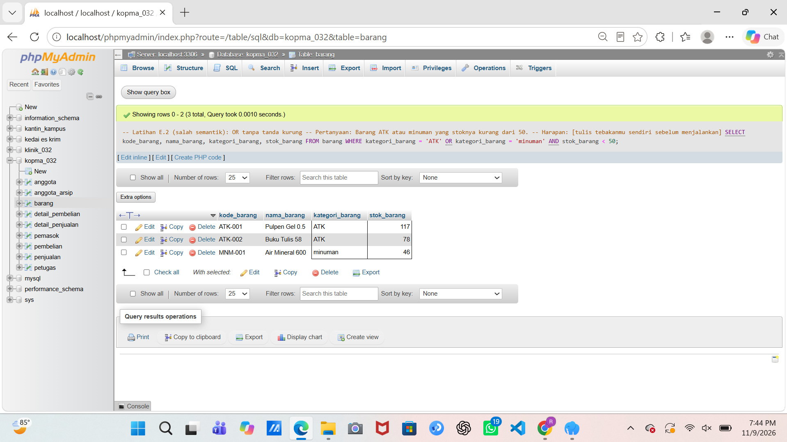
*Hasil salah: tiga barang muncul karena `AND` didahulukan.*

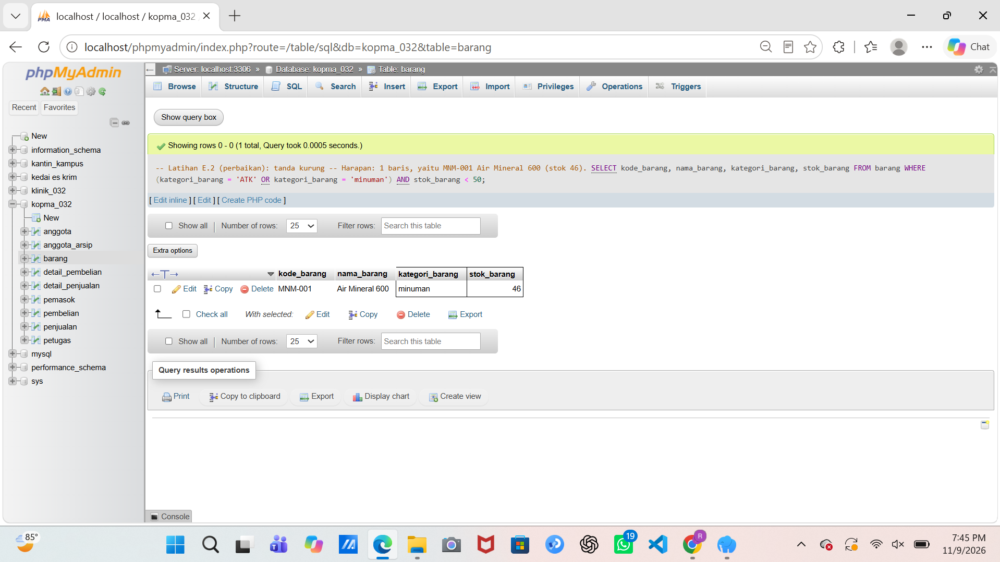
*Hasil benar setelah diberi tanda kurung: satu barang.*

## 6. Tugas Mandiri: Milestone Proyek 7

Proyek: Klinik Sehat RNJ (`klinik_032`). Berkas: `p07_kueri_25430032.sql`, berisi 11 kueri satu tabel, masing-masing dengan komentar kode KI, pertanyaan, dan harapan.

### 6.1 Pemetaan kueri ke KI

| Kueri | KI | Tabel | Keterangan |
|---|---|---|---|
| Q1 | KI-03 | `obat` | Obat dengan stok di bawah batas minimum. Hasilnya kosong karena semua stok masih aman. |
| Q2 | KI-03 | `obat` | Peringatan dini: stok kurang dari 5 kali batas minimum (Salep Hidrokortison dan Oralit). |
| Q3 | KI-01 (daftar) | `kunjungan` | Kunjungan pada 28 Oktober 2026. Jumlah per hari butuh agregasi. |
| Q4 | KI-02 (daftar) | `pasien` | Pasien yang mendaftar September 2025. Jumlah per bulan butuh agregasi. |
| Q5 | KI-02 (daftar) | `pasien` | Pasien yang mendaftar tahun 2026. |
| Q6 | latihan operator | `pasien` | Pencarian nama dengan `LIKE`. |
| Q7 | latihan operator | `tenaga_kesehatan` | Peran dokter dengan `IN`. |
| Q8 | latihan operator | `pasien` | Pasien tanpa nomor HP dengan `IS NULL`. |
| Q9 | latihan fungsi | `pasien` | Umur dan kategori usia dengan `CASE`, `TIMESTAMPDIFF`, `CONCAT`, `UPPER`. |
| Q10 | latihan operator | `kunjungan` | Keluhan yang menyebut demam dengan `LIKE`. |
| Q11 | KI-05 (daftar) | `pemeriksaan` | Pemeriksaan dengan diagnosis tertentu pada rentang tanggal. "Paling sering" butuh agregasi. |

**KI yang belum dapat dijawab satu tabel:**
- **KI-01, KI-02, dan KI-05** meminta jumlah atau peringkat, sehingga butuh `COUNT` dan `GROUP BY`. Kueri di atas baru menjawab daftarnya. Jawaban penuhnya dikerjakan di Pertemuan 9–12.
- **KI-04** (total pembayaran per bulan) belum dapat dijawab karena dokumen Pertemuan 2 mencantumkan entitas Pembayaran, tetapi `klinik_032` belum memiliki tabel `pembayaran`.

### 6.2 Alasan pemilihan operator dan fungsi skalar

- **`IN`** (Q7, Q11): daftar nilai tertentu lebih ringkas dan lebih mudah dibaca daripada rangkaian `OR`.
- **`BETWEEN`** (Q3, Q4): cocok untuk rentang. Pada kolom `DATETIME` (Q3) batas akhir ditulis `23:59:59` agar nota sore hari tidak terlewat. Pada kolom `DATE` (Q4) cukup tanggal.
- **`>=` dan `<`** (Q11): rentang setengah terbuka dipilih untuk `DATETIME` karena tidak bergantung pada ketelitian detik.
- **`LIKE`** (Q6, Q10): untuk mencari potongan teks yang tidak diketahui posisinya.
- **`IS NULL`** (Q8): satu-satunya cara yang benar memeriksa nilai kosong.
- **`CASE`** (Q9): untuk mengubah nilai menjadi kategori yang mudah dibaca. Ekspresi umur diulang di `CASE` karena alias belum dikenal pada tahap itu.
- **`YEAR`, `DATE_FORMAT`, `TIMESTAMPDIFF`** (Q5, Q3, Q9): memisahkan bagian tanggal, memformat tampilan, dan menghitung umur dari tanggal lahir. Catatan: `YEAR(kolom) = 2026` pada Q5 sebaiknya diganti rentang tanggal bila nanti kinerja kueri diukur, karena fungsi pada kolom membuat indeks tidak terpakai.
- **`CONCAT`, `UPPER`** (Q9): menyusun label pasien yang konsisten.

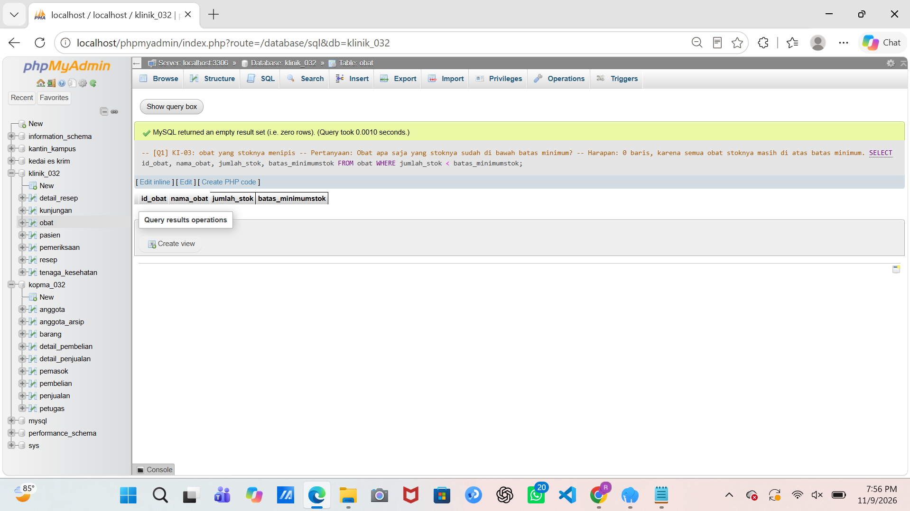
*Q1: tidak ada obat yang stoknya di bawah batas minimum (hasil kosong).*

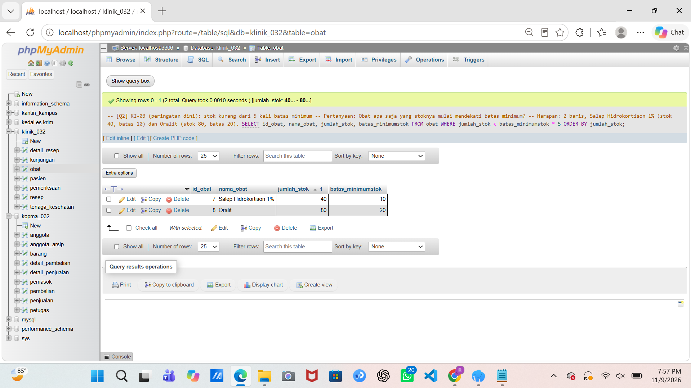
*Q2: dua obat dengan stok kurang dari 5 kali batas minimum.*

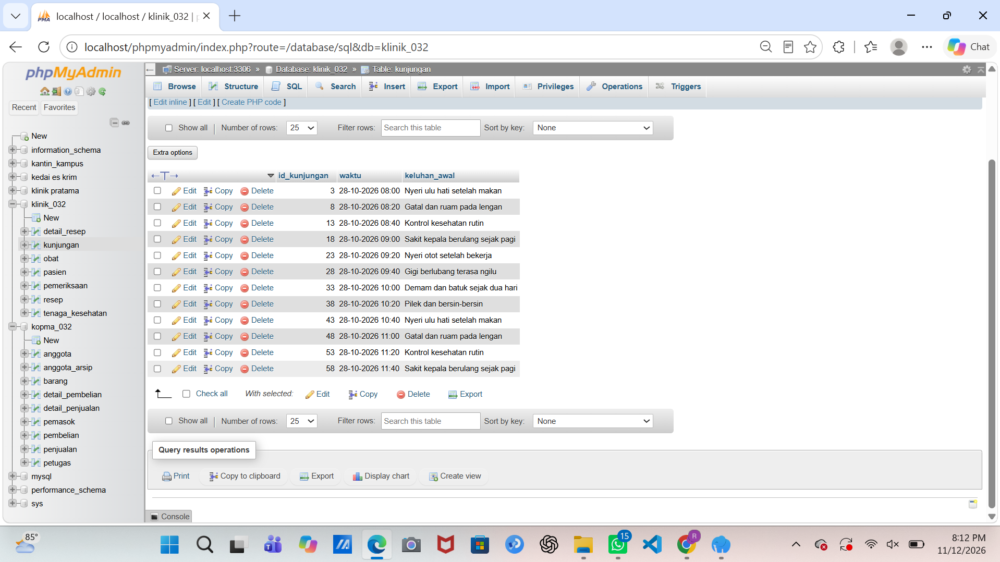
*Q3: 12 kunjungan pada 28 Oktober 2026.*

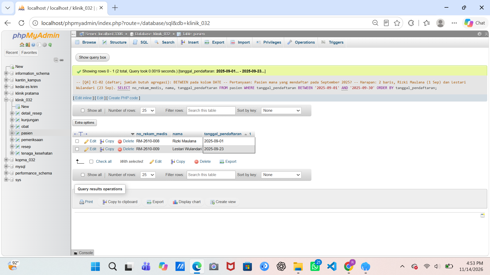
*Q4: dua pasien mendaftar September 2025.*

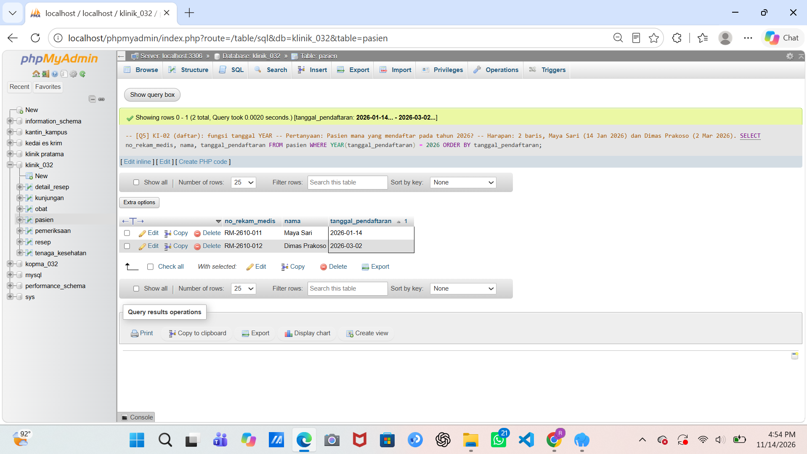
*Q5: dua pasien mendaftar tahun 2026.*

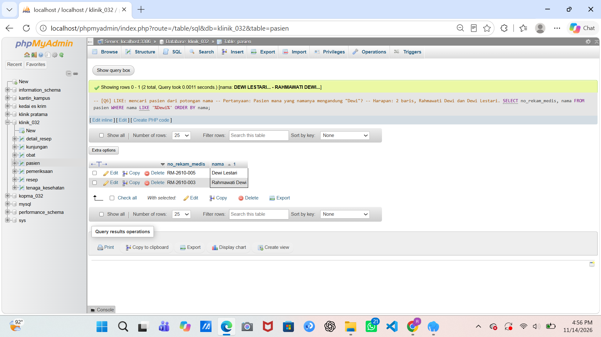
*Q6: pasien yang namanya mengandung "Dewi".*

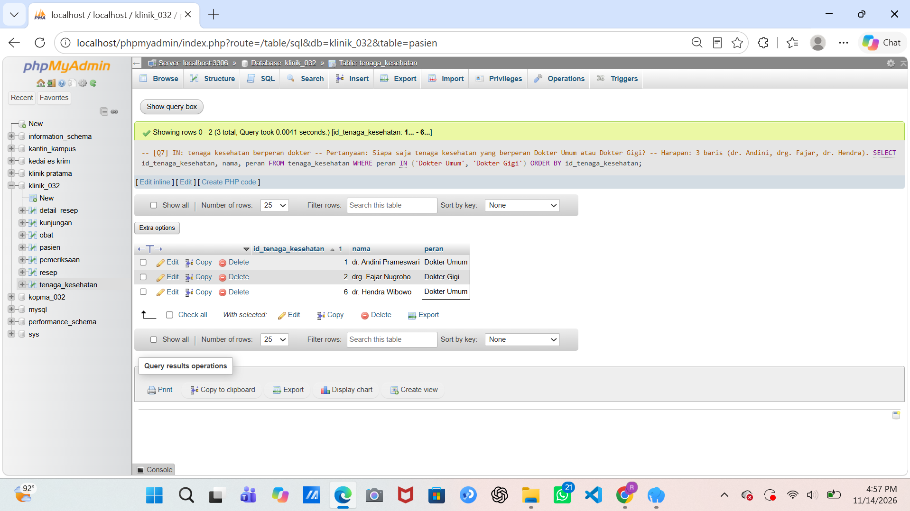
*Q7: tenaga kesehatan berperan dokter.*

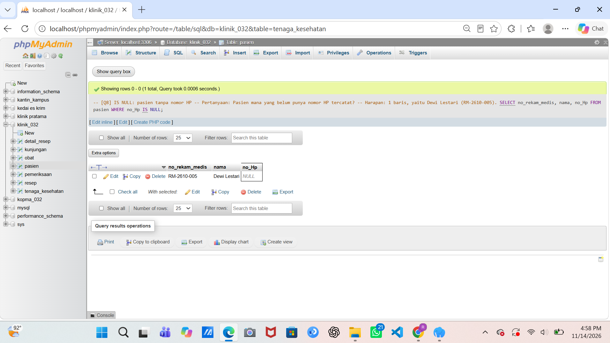
*Q8: pasien tanpa nomor HP.*

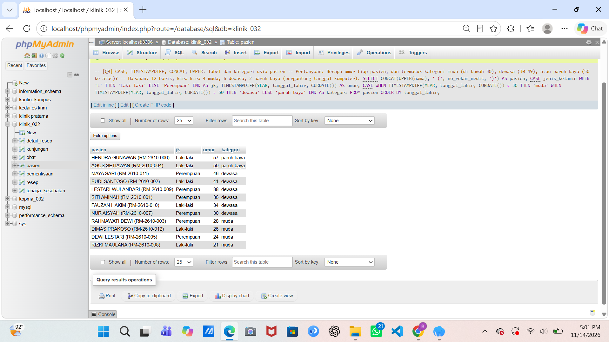
*Q9: umur dan kategori usia seluruh pasien.*

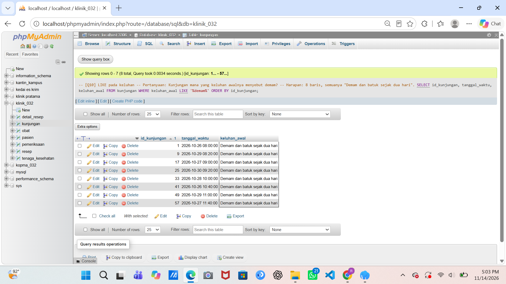
*Q10: delapan kunjungan dengan keluhan demam.*

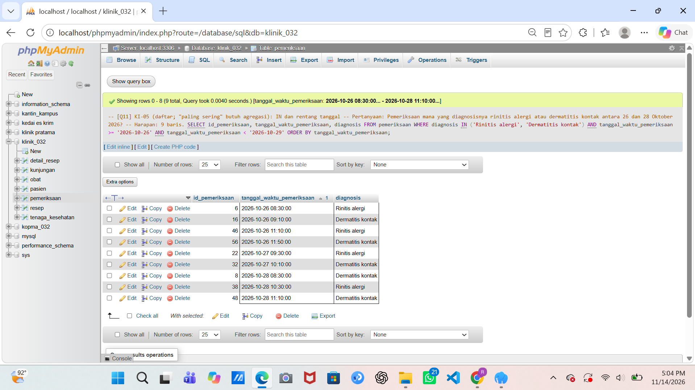
*Q11: pemeriksaan dengan diagnosis rinitis alergi atau dermatitis kontak pada 26–28 Oktober 2026.*

## 7. Pembahasan dan Kendala

1. **MySQL di XAMPP tidak bisa menyala.** Log `mysql_error.log` menunjukkan pemulihan mesin Aria gagal (`Aria recovery failed ... delete all aria_log files`), sehingga tabel sistem tidak terbuka dan MySQL berhenti. Setelah itu saya memindahkan pekerjaan ke Laragon, memeriksa bahwa jumlah baris tiap tabel tetap sama, dan melanjutkan praktikum di sana.
2. **Hasil kueri kosong tidak berarti salah.** Pada Q1 klinik hasilnya kosong karena stok semua obat memang di atas batas minimum. Untuk memastikan bukan kesalahan kueri, saya menambahkan Q2 dengan syarat yang lebih longgar dan hasilnya muncul.
3. **Alias yang sama dengan nama kolom.** Pada kueri anggota, alias tanggal diberi nama berbeda dari nama kolomnya agar `ORDER BY` memakai kolom tanggal aslinya, bukan teks hasil format.
4. **Hasil bergantung pada tanggal komputer.** Hasil `CURDATE()` pada kueri umur dan lama keanggotaan berubah mengikuti tanggal, jadi angkanya dicatat sebagai hasil pada hari pengujian.

## 8. Kesimpulan

Kueri `SELECT` satu tabel cukup untuk menjawab sebagian KI, tetapi KI yang meminta jumlah atau peringkat membutuhkan agregasi dan gabungan tabel. Urutan evaluasi menjelaskan kenapa alias tidak dikenal di `WHERE`, dan perlakuan khusus `NULL` serta prioritas `AND` terhadap `OR` menunjukkan bahwa kueri bisa berjalan tanpa galat tetapi tetap memberi hasil yang salah, sehingga hasil harus dicek dengan harapan yang ditulis lebih dulu.

## 9. Pernyataan Penggunaan AI

Saya menggunakan Claude (Anthropic) untuk membantu menyusun kerangka kueri dan komentar harapan, memberi perkiraan hasil sebagai pembanding, menjelaskan pesan galat, dan menyusun kerangka laporan. Semua kueri saya jalankan sendiri di komputer saya, dan tangkapan layar serta hasil nyata berasal dari komputer saya. Jawaban Titik Analisis dan penjelasan saya baca, cocokkan dengan hasil yang saya lihat, dan sesuaikan sebelum dikumpulkan.

## 10. Bukti Git

- Repositori: https://github.com/rnurjazilah-cyber/basisdata-032

## Checklist

### Checklist khusus Pertemuan 7

| Status | Jenis | Yang harus ada |
|---|---|---|
| [√] | Berkas wajib | `p07_kueri_25430032.sql` berisi minimal 10 kueri satu tabel, masing-masing diberi komentar KI dan hasil yang diharapkan |
| [√] | Bukti tangkapan layar | Hasil setiap kueri |
| [√] | Analisis wajib | Pemetaan kueri → KI; alasan pemilihan fungsi skalar yang dipakai |

### Checklist umum

| Status | Butir | Yang harus ada |
|---|---|---|
| [√] | Identitas | Nama, NIM, kelas, pertemuan ke-7, tanggal pelaksanaan, nama asisten/dosen |
| [√] | Tujuan | Tujuan praktikum ditulis ulang dengan bahasa sendiri (maksimal 5 baris) |
| [√] | Ringkasan teori | Pemahaman sendiri atas Dasar Teori, maksimal setengah halaman |
| [√] | Langkah percobaan (D) | Tangkapan layar hasil langkah kunci, masing-masing diberi keterangan singkat |
| [√] | Titik Analisis | Semua Titik Analisis dijawab lengkap dengan alasan |
| [√] | Latihan (E) | Kueri hasil latihan beserta bukti berjalan |
| [√] | Tugas Mandiri (F) | Milestone proyek: berkas, bukti, dan penjelasan keputusan desain |
| [√] | Pembahasan dan kendala | Galat yang ditemui, cara membacanya, dan cara mengatasinya |
| [√] | Kesimpulan | Dua sampai empat kalimat dengan bahasa sendiri |
| [√] | Pernyataan Penggunaan AI | Alat yang dipakai, untuk apa, dan bagian mana |
| [√] | Bukti Git | Tautan repositori pertemuan ini |
| [√] | Keaslian | Setiap tangkapan layar memperlihatkan akun ber-NIM dan jam sistem |
