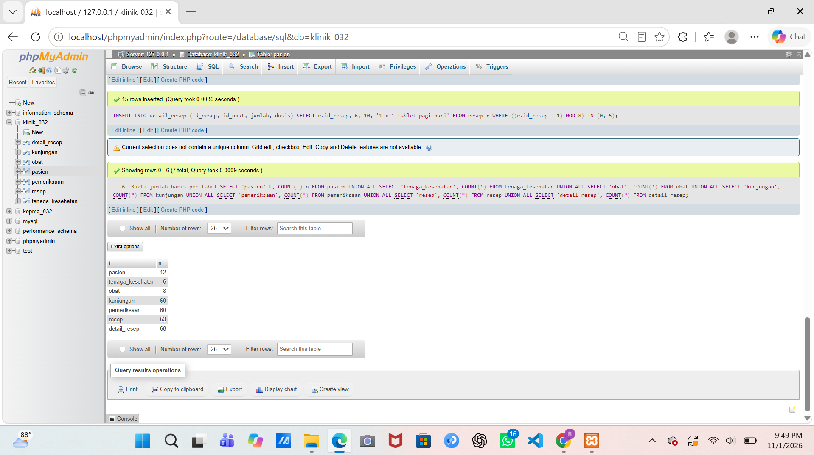
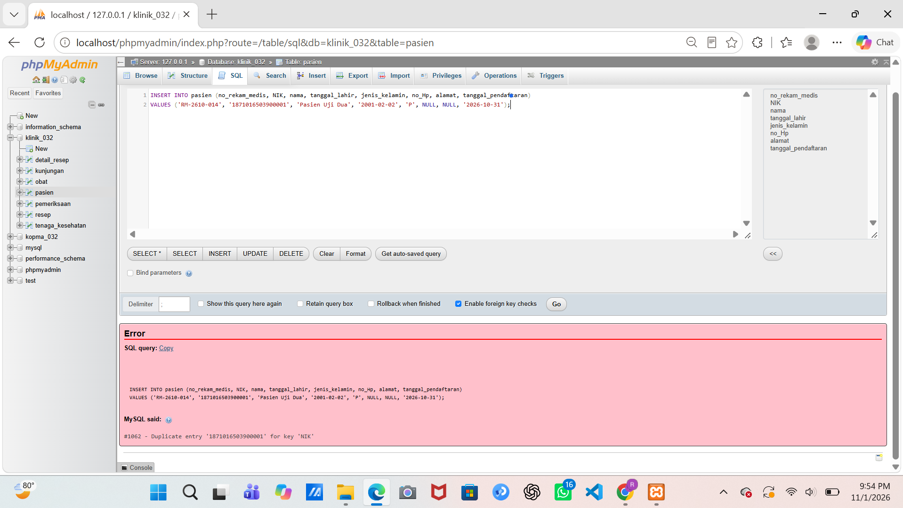
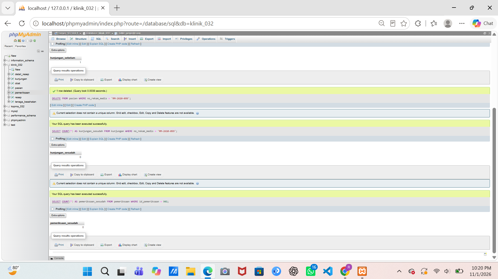

# Skenario Uji Klinik — Milestone Proyek 6

**Nama:** Riska Nur Jazilah
**NPM:** 25430032
**Kelas:** A
**Basis data:** `klinik_032`

## 1. Data sampel

`p06_data_25430032.sql` mengosongkan tujuh tabel dengan `TRUNCATE`, lalu mengisinya, sehingga bisa dijalankan ulang dengan hasil yang sama. Tabel transaksi utama adalah `kunjungan` dengan 60 baris pada 5 tanggal berbeda (26–30 Oktober 2026). Nilai parameter P adalah 6 (NPM berakhiran 32, 32 mod 9 = 5, ditambah 1), sehingga syarat minimalnya 10 × P = 60 baris.

| Tabel | Baris |
|---|---|
| pasien | 12 |
| tenaga_kesehatan | 6 |
| obat | 8 |
| kunjungan | 60 |
| pemeriksaan | 60 |
| resep | 53 |
| detail_resep | 68 |

Resep tidak dibuat untuk kunjungan kontrol rutin, sehingga jumlahnya 53. Setiap resep berisi satu atau dua jenis obat, di bawah batas P + 2 = 8 item per transaksi.

## 2. Hasil skenario uji

| Kode | Skenario | Harapan | Hasil nyata | Status | Aturan |
|---|---|---|---|---|---|
| UP01 | Kunjungan baru untuk pasien dan tenaga kesehatan yang ada | Diterima | `1 row inserted` | LULUS | AB-02 |
| UP02 | Pasien tanpa nomor HP dan alamat (NULL) | Diterima | `1 row inserted` | LULUS | skema: no_Hp dan alamat boleh kosong |
| UN01 | Pasien dengan NIK yang sudah dipakai | Ditolak, ERROR 1062 | ERROR 1062, Duplicate entry `1871016503900001` | LULUS | kamus data: NIK wajib dan unik |
| UN02 | Pasien dengan nomor HP yang sudah dipakai | Ditolak, ERROR 1062 | ERROR 1062, Duplicate entry `081210000001` | LULUS | UNIQUE no_Hp |
| UN03 | Kunjungan untuk nomor rekam medis yang tidak ada | Ditolak, ERROR 1452 | ERROR 1452, foreign key gagal | LULUS | AB-02 |
| UN04 | Stok obat diubah menjadi -1 | Ditolak, ERROR 4025 | `#4025 - CONSTRAINT ck_obat_stok failed for klinik_032.obat` | LULUS | AB-07 |
| UN05 | Detail resep dengan jumlah 0 | Ditolak, ERROR 4025 | ERROR 4025, `ck_dresep_jumlah` gagal | LULUS | AB-06 |
| UN06 | Obat yang sama dua kali pada satu resep | Ditolak, ERROR 1062 | `#1062 - Duplicate entry '1-1' for key 'PRIMARY'` | LULUS | AB-06 |
| UN07 | UPDATE tanpa WHERE di mode aman | Ditolak, ERROR 1175 | `#1175 - You are using safe update mode and you tried to update a table without a WHERE that uses a KEY column` | LULUS | kebijakan lab |
| UG01 | Hapus pasien yang punya riwayat kunjungan | Seharusnya ditolak | Diterima: `1 row deleted`; kunjungan_sesudah = 0, pemeriksaan_sesudah = 0 | **GAGAL** | AB-02, AB-03; data kunjungan disimpan minimal 5 tahun |

Dari 10 skenario, 9 sesuai harapan dan 1 (UG01) gagal sesuai prediksi. Tujuh di antaranya adalah uji negatif (UN01 sampai UN07), memenuhi syarat minimal lima.

## 3. Perintah yang dijalankan

**UP01**
```sql
INSERT INTO kunjungan (id_kunjungan, tanggal_waktu, keluhan_awal, no_rekam_medis, id_tenaga_kesehatan)
VALUES (61, '2026-10-31 09:00:00', 'Kontrol tekanan darah', 'RM-2610-001', 1);
```

**UP02**
```sql
INSERT INTO pasien (no_rekam_medis, NIK, nama, tanggal_lahir, jenis_kelamin, no_Hp, alamat, tanggal_pendaftaran)
VALUES ('RM-2610-013', '1871010101010013', 'Pasien Uji Satu', '2001-01-01', 'L', NULL, NULL, '2026-10-31');
```

**UN01**
```sql
INSERT INTO pasien (no_rekam_medis, NIK, nama, tanggal_lahir, jenis_kelamin, no_Hp, alamat, tanggal_pendaftaran)
VALUES ('RM-2610-014', '1871016503900001', 'Pasien Uji Dua', '2001-02-02', 'P', NULL, NULL, '2026-10-31');
```

**UN02**
```sql
INSERT INTO pasien (no_rekam_medis, NIK, nama, tanggal_lahir, jenis_kelamin, no_Hp, alamat, tanggal_pendaftaran)
VALUES ('RM-2610-015', '1871010303030015', 'Pasien Uji Tiga', '2001-03-03', 'L', '081210000001', NULL, '2026-10-31');
```

**UN03**
```sql
INSERT INTO kunjungan (id_kunjungan, tanggal_waktu, keluhan_awal, no_rekam_medis, id_tenaga_kesehatan)
VALUES (62, '2026-10-31 10:00:00', 'Uji pasien tidak ada', 'RM-9999-999', 1);
```

**UN04**
```sql
UPDATE obat SET jumlah_stok = -1 WHERE id_obat = 1;
```

**UN05**
```sql
INSERT INTO detail_resep (id_resep, id_obat, jumlah, dosis) VALUES (1, 2, 0, '1 x 1 kapsul');
```

**UN06**
```sql
INSERT INTO detail_resep (id_resep, id_obat, jumlah, dosis) VALUES (1, 1, 5, '3 x 1 tablet');
```

**UN07**
```sql
SET SESSION sql_safe_updates = 1;
UPDATE obat SET harga = harga * 1.1;
```

**UG01** (memakai pasien sementara agar data utama tetap utuh)
```sql
INSERT INTO pasien (no_rekam_medis, NIK, nama, tanggal_lahir, jenis_kelamin, no_Hp, alamat, tanggal_pendaftaran)
VALUES ('RM-2610-099', '1871010909090099', 'Pasien Uji Hapus', '1999-09-09', 'L', NULL, NULL, '2026-10-31');
INSERT INTO kunjungan (id_kunjungan, tanggal_waktu, keluhan_awal, no_rekam_medis, id_tenaga_kesehatan)
VALUES (901, '2026-10-31 11:00:00', 'Uji hapus pasien', 'RM-2610-099', 1);
INSERT INTO pemeriksaan (id_pemeriksaan, tanggal_waktu_pemeriksaan, diagnosis, tindakan, hasil_pemeriksaan, id_kunjungan)
VALUES (901, '2026-10-31 11:10:00', 'Uji diagnosis', NULL, NULL, 901);

SELECT COUNT(*) AS kunjungan_sebelum FROM kunjungan WHERE no_rekam_medis = 'RM-2610-099';
DELETE FROM pasien WHERE no_rekam_medis = 'RM-2610-099';
SELECT COUNT(*) AS kunjungan_sesudah FROM kunjungan WHERE no_rekam_medis = 'RM-2610-099';
SELECT COUNT(*) AS pemeriksaan_sesudah FROM pemeriksaan WHERE id_pemeriksaan = 901;
```

## 4. Penjelasan

- **UP01 dan UP02.** Uji positif: data yang sah tidak boleh dihalangi aturan. Pasien dan tenaga kesehatan yang dirujuk ada, dan nomor HP serta alamat memang boleh kosong.
- **UN01 dan UN02.** NIK dan nomor HP adalah batasan unik, sehingga satu orang tidak bisa terdaftar dua kali dan satu nomor tidak bisa dipakai dua pasien.
- **UN03.** Kunci tamu menjaga AB-02: setiap kunjungan harus tercatat untuk satu pasien yang terdaftar.
- **UN04.** `CHECK` menjaga AB-07: stok obat tidak boleh negatif.
- **UN05 dan UN06.** Aturan AB-06 menuntut setiap resep mencatat obat dan jumlah yang valid. Jumlah harus lebih dari nol, dan kunci gabungan `id_resep` + `id_obat` mencegah obat yang sama muncul dua kali di satu resep.
- **UN07.** Mode aman menolak `UPDATE` tanpa syarat kolom kunci, karena akan mengubah harga semua obat sekaligus.
- **UG01.** Seluruh kunci tamu bernilai `CASCADE`, sehingga menghapus satu pasien ikut menghapus kunjungan, pemeriksaan, dan resepnya. Ini sesuai desain, tetapi berbahaya untuk data medis.

## 5. Utang desain untuk Modul 14

Semua relasi (`fk_kunjungan_pasien`, `fk_kunjungan_nakes`, `fk_pemeriksaan_kunjungan`, `fk_resep_pemeriksaan`, `fk_dresep_resep`, `fk_dresep_obat`) berupa `ON DELETE CASCADE`. Menghapus pasien atau tenaga kesehatan menghapus seluruh riwayat medisnya tanpa jejak. Hal ini juga bertentangan dengan kebutuhan non-fungsional pada dokumen kebutuhan data Pertemuan 2, yaitu data kunjungan dirancang untuk disimpan minimal 5 tahun. Rencana: ubah relasi riwayat menjadi RESTRICT, atau tambahkan kolom status nonaktif pada pasien dan tenaga kesehatan. Selain itu, stok obat belum berkurang otomatis ketika resep dibuat, padahal AB-07 mensyaratkan obat hanya diberikan jika stok mencukupi; ini butuh transaksi atau trigger.

## 6. Tangkapan layar






